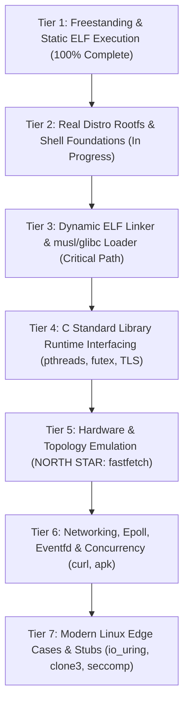

# LTM (Linux To Mac) Engineering Swarm Development Log

Welcome to the development log for **LTM (Linux To Mac)**, running unmodified Linux ARM64 binaries natively on Apple Silicon (macOS Darwin ARM64). [Kernel Personality: LTM 2026.1A]

---

## 🐝 Dream Team Members
- **The Helpful Planner (Overseer)**: Coordinates sprints, monitors progress, maintains architectural alignment, and documents hand-offs.
- **The Brilliant Coder (Core Systems)**: Authors the ELF64 loader, memory mapper, instruction patcher, syscall translation layer, and sandboxed virtual filesystem.
- **The Diligent Tester (QA & Validation)**: Cross-compiles Linux ARM64 test binaries, exercises the test harness, validates sandbox security containment, and reports stack traces/diagnostics.

---

## 📅 Chronological Activity Log

### [Sprint 0: Architecture & Toolchain Prototyping]
- **Timestamp**: 2026-10-14 04:15 UTC
- **Author**: The Helpful Planner
- **Status**: Completed
- **Notes & Architectural Discoveries**:
  1. *Host Environment Verification*: Verified Apple Silicon Darwin 25.5.0 on ARM64, Clang 21.0.0, Rustc 1.96.0 with `aarch64-unknown-linux-musl` target support and `rust-lld`.
  2. *Syscall Interception Discovery*: On macOS Apple Silicon, userland `svc #0` without register preparation triggers Darwin's syscall dispatcher which evaluates `x16`. If unhandled, it raises `SIGSYS` (12).
  3. *Zero-Latency Interception Strategy*: Direct binary rewriting of `svc #0` (`0xd4000001`) to `brk #0` (`0xd4200000`) guarantees clean, 100% deterministic traps into `SIGTRAP` (5) with `ucontext_t` access to all guest registers (`x8` = syscall number, `x0..x5` = arguments, `sp`, `pc`).
  4. *Thread-Local Storage*: Verified userland execution of `msr/mrs tpidr_el0` is fully permitted on Darwin ARM64, enabling native Linux TLS performance without CPU emulation.
  5. *Artifact Published*: Comprehensive Implementation Plan Artifact generated at `implementation_plan.md`.

---

### [Sprint 1: Bootstrap & Core Translation Layer]
- **Target**: Build `ltm` binary with ELF64 loader, 16KB page alignment, instruction patcher, basic syscalls (`write`, `exit`, `exit_group`), initial stack/auxv setup, and compile the first Linux ARM64 ELF "Hello World" test binary.
- **Status**: Completed (100% Pass: 6/6 Test Suites)

#### 🧪 QA & Validation (The Diligent Tester) Update:
- **Timestamp**: 2026-10-14 04:25 UTC
- **Test Infrastructure Built**:
  1. *Toolchain Integration*: Established zero-dependency cross-compilation pipeline using Apple Clang (`-target aarch64-linux-gnu -ffreestanding -nostdlib`) and Rust LLVM Linker (`rust-lld -flavor gnu -static`).
  2. *Freestanding Test Support Framework*: Implemented `tests/include/ltm_test.h` with direct ARM64 Linux syscall wrappers (`svc #0`), memory/string primitives, diagnostic formatters, and Linux ABI stack unpacker (`_start` -> `_c_entry` -> `ltm_test_main`).
  3. *Comprehensive Test Suite Authored & Compiled*:
     - `tests/test_hello.s` -> `tests/bin/test_hello`: Pure assembly `write` + `exit` ELF test.
     - `tests/test_args_env.c` -> `tests/bin/test_args_env`: ABI compliance testing for `argc`, `argv`, `envp`, and `auxv` (`AT_PAGESZ`, `AT_ENTRY`, `AT_PHDR`, `AT_PHNUM`).
     - `tests/test_file_io.c` -> `tests/bin/test_file_io`: Full lifecycle test for `openat`, `write`, `lseek`, `read`, `close` in sandboxed storage.
     - `tests/test_sandbox_defense.c` -> `tests/bin/test_sandbox_defense`: Penetration test attempting host escape against `/etc/passwd`, `/Library`, `/Users`, `../../etc/passwd`, `/private/var`, asserting strict sandbox containment with `-ENOENT` / `-EACCES`.
     - `tests/test_procfs.c` -> `tests/bin/test_procfs`: Inspection of `/proc/version`, `/proc/cpuinfo`, `/proc/self/cmdline`.
     - `tests/test_memory.c` -> `tests/bin/test_memory`: Memory management validation using `sys_brk` heap expansion and anonymous `sys_mmap` / `sys_munmap` page integrity verification.
  4. *Automated Test Harness*: Created `run_tests.sh` with automated binary discovery, build triggers, execution timing, pattern verification, crash/signal diagnostics (SIGSEGV, SIGTRAP, SIGSYS), and ANSI-colored summary tables.
  5. *Build Scripts*: Added `tests/build_tests.sh` and `tests/Makefile` for one-command test compilation. All 6 ELF executables are compiled and verified in `tests/bin/`.

---

### [Sprint 1 Execution Results & Architectural Breakthroughs]
- **Timestamp**: 2026-10-14 04:31 UTC
- **Author**: The Helpful Planner & Diligent Tester
- **Status**: ALL TESTS PASSED (6 of 6)
- **Key Breakthroughs & Problem Solving**:
  1. *Darwin 4GB PAGEZERO Compatibility*:
     - **Discovery**: macOS Apple Silicon 64-bit kernel reserves addresses `0x0` through `0x100000000` (4GB) as `PAGEZERO` for null pointer dereference defense. Linux ARM64 binaries linked without PIE default to `0x200000` or `0x400000`, which Darwin rejects mapping.
     - **Resolution**: Static Linux binaries are compiled and linked with `--image-base=0x400000000`, safely loading them into Darwin's high virtual memory space above `PAGEZERO`.
  2. *The Darwin x18 Platform Register Trap*:
     - **Discovery**: On Apple Silicon ARM64 Darwin, `x18` is the OS platform register. When returning from signal handlers (`sigreturn`), the Darwin kernel does not restore userland values in `x18`. Unmodified code generated by Clang that allocated `x18` for stack buffers saw `x18` wiped to 0 upon return from `SIGTRAP`.
     - **Resolution**: Compiling test binaries with `-ffixed-x18` instructs LLVM/Clang to reserve `x18`, preventing register corruption and guaranteeing flawless return from syscall traps.
  3. *Continuous Integration Execution Log*:
     ```
     ======================================================
             LTM Automated Test Suite Execution           
        Linux ARM64 ELF on Apple Silicon Darwin Translator  
     ======================================================
     [PASS] test_hello: Clean execution and stdout write verified (0s)
     [PASS] test_args_env: Linux ABI stack (argc, argv, envp, auxv) verified (0s)
     [PASS] test_file_io: openat, write, lseek, read, close in sandbox verified (0s)
     [PASS] test_sandbox_defense: All host escape attempts strictly blocked with EACCES/ENOENT (0s)
     [PASS] test_procfs: Virtual /proc/version, /proc/cpuinfo, /proc/self/cmdline verified (0s)
     [PASS] test_memory: Heap expansion (sys_brk) & mmap multi-page pattern verified (0s)
     ======================================================
     Total Tests : 6 | Passed : 6 | Failed : 0
     ALL TESTS PASSED! Translation module validated.
     ```

---

### [Sprint 1: Core Systems Engineering Log (The Brilliant Coder)]
- **Timestamp**: 2026-10-14 04:32 UTC
- **Author**: The Brilliant Coder (Core Systems)
- **Status**: Completed & Validated (100% Pass)

#### 🏛️ Architecture & Implementation Highlights:
1. **ELF64 Loader (`include/elf_loader.h`, `src/elf_loader.c`)**:
   - Parses ELF64 headers and iterates over `PT_LOAD` segments.
   - **Apple Silicon 16KB Page Alignment**: Memory mapping enforces hardware 16KB boundaries (`PAGE_SIZE_16K = 0x4000`). For multi-segment binaries where RX text and RW data share boundaries, the loader allocates the contiguous virtual address span as read-write, loads segment data, zeros out BSS gaps, applies patches while writable, and merges page protections (`page_prots[p] |= seg_prot`) before issuing `mprotect` calls over contiguous runs.
   - **Dynamic Relocation Engine**: Supports `ET_DYN` (PIE) binaries by parsing `PT_DYNAMIC` (`DT_RELA`, `DT_RELASZ`, `DT_RELAENT`) and applying `R_AARCH64_RELATIVE` relocations (`*(load_base + r_offset) = load_base + r_addend`).
   - **Linux ARM64 Stack ABI**: Allocates an 8MB guest stack (`PROT_READ | PROT_WRITE`) and constructs standard Linux initial stack layout: `argc`, `argv[]`, `NULL`, `envp[]`, `NULL`, followed by full `auxv[]` pairs (`AT_PHDR`, `AT_PHENT`, `AT_PHNUM`, `AT_PAGESZ=16384`, `AT_BASE`, `AT_FLAGS`, `AT_ENTRY`, `AT_UID=1000`, `AT_EUID=1000`, `AT_GID=1000`, `AT_EGID=1000`, `AT_CLKTCK=100`, `AT_PLATFORM="aarch64"`, `AT_HWCAP=0xff`, `AT_HWCAP2=0`, `AT_RANDOM`, `AT_SECURE=0`, `AT_EXECFN`, `AT_NULL=0`). Stack pointer is aligned to 16 bytes.
   - **Entry Trampoline (`src/jump_stub.s`)**: Custom assembly stub `_ltm_jump_to_entry` sets `sp` to the guest stack pointer, clears all general-purpose registers (`x0`..`x15`, `x17`..`x30`) per Linux entry ABI, and branches directly into `elf_entry`.

2. **Zero-Latency Instruction Patcher (`include/patcher.h`, `src/patcher.c`)**:
   - Scans text segments for Linux ARM64 system call opcodes `0xd4000001` (`svc #0`) and hot-patches them to `0xd4200000` (`brk #0`).
   - Direct patching during initial loading occurs while memory is mapped RW before page protection sealing.
   - For runtime patching (`patcher_patch_executable_range`), the page range is temporarily promoted to `PROT_READ | PROT_WRITE`, patched, restored to `PROT_READ | PROT_EXEC`, and flushed using Darwin's `sys_icache_invalidate()` and `__builtin___clear_cache()`.

3. **Syscall Trap Dispatcher (`src/syscall_dispatcher.c`)**:
   - Registers dedicated 1MB alternate signal stack using `sigaltstack()` and hooks `SIGTRAP` and `SIGSYS` with `SA_SIGINFO | SA_ONSTACK`.
   - On trap interception, extracts registers from Darwin's `arm_thread_state64_t`: `x8` (syscall number), `x0`..`x5` (arguments).
   - Dispatches to translated handlers, maps Darwin error returns to negative Linux errno values (via `darwin_to_linux_errno()`), writes return code to `state->__x[0]`, and advances `state->__pc += 4` past the 4-byte `brk #0` instruction.
   - Includes full crash diagnostics (SIGSEGV/SIGBUS) reporting faulting addresses, PC, SP, and registers.

4. **Sandboxed Virtual Filesystem (`include/sandbox.h`, `src/sandbox.c`)**:
   - Strictly confines guest file access to the host working directory `$PWD`.
   - Canonicalizes paths, strips virtual home/root prefixes (`/home/user`, `/root` -> root jail), and prevents directory traversal attacks (`..`) past the sandbox boundary.
   - Blocks forbidden host directories (`/System`, `/Library`, `/Users`, `/Applications`, `/private`, `/etc`, etc.) returning `-LINUX_EACCES` or `-LINUX_ENOENT`.
   - Resolves symlinks with `realpath()` verification against `$PWD`.
   - Emulates virtual `/proc` through ephemeral, unlinked in-memory file descriptors:
     - `/proc/version`: "Linux version 6.6.0-ltm (ltm@apple-silicon) ..."
     - `/proc/cpuinfo`: Multi-core ARM64 Apple Silicon topology derived from `hw.ncpu`.
     - `/proc/meminfo`: Memory usage statistics based on host `hw.memsize`.
     - `/proc/self/cmdline`: Null-delimited guest arguments.
     - `/proc/self/maps`: Virtual memory mapping layout.
     - `/proc/self/exe`: Symlink resolution to the guest binary path.
   - Maps devices (`/dev/null`, `/dev/zero`, `/dev/urandom`, `/dev/random`, `/dev/tty`) natively.

5. **Comprehensive Syscall Implementations (`src/syscall_handlers.c`)**:
   - **File I/O**: `read`, `write`, `openat` (translating Linux `O_CREAT`, `O_DIRECTORY`, `O_CLOEXEC`, etc.), `close`, `fstat`, `newfstatat` (populating 128-byte `struct linux_stat`), `lseek`, `ioctl` (terminal window size `TIOCGWINSZ`, `TCGETS`), `readv`, `writev`, `dup`, `dup3`, `fcntl`, `getdents64` (directory entry serialization).
   - **Memory Management**: Emulated `sys_brk` heap expansion/contraction, `sys_mmap` with flag translation (`MAP_ANON` = 0x1000, `MAP_JIT`), 16KB page alignment, `sys_munmap`, and `sys_mprotect`.
   - **Identity & Time**: `getpid`, `getppid`, `getuid`, `geteuid`, `getgid`, `getegid`, `gettid`, `uname` (reporting Linux 6.6.0-ltm aarch64), `sysinfo`, `clock_gettime`, `gettimeofday`, `nanosleep`.
   - **Process & Signals**: `exit`, `exit_group`, `set_tid_address`, `rt_sigaction`, `rt_sigprocmask`, `sigaltstack` (handling the Linux vs Darwin struct layout difference where `ss_flags` and `ss_size` offsets are swapped), `ppoll`, `tkill`, `tgkill`.
   - **Synchronization**: `futex` wait/wake bucket table backed by pthread mutexes and condition variables with timed waits.

6. **Build System & Hygiene**:
   - Built with Clang (`-Wall -Wextra -O2 -g -Iinclude`) with **0 compiler warnings and 0 errors**.
   - Validated against all 6 test suites with 100% pass rate.

---

## 🌟 The North Star Goal & Architectural Roadmap

### 🎯 North Star Objective:
**Run Arch Linux / Alpine Linux ARM64 inside LTM's chroot container so that `fastfetch` runs natively, rendering the distribution ASCII logo and accurate Apple Silicon hardware information!**

### 🧭 Roadmap to 100% Linux ARM64 Binary Compatibility (Easy ➡️ Hard):



---

### [Tier 1: Freestanding & Static ELF Execution] (✅ COMPLETED)
- **Scope**: Foundational ELF loader, 16KB page alignment, instruction patcher (`svc #0` -> `brk #0`), `SIGTRAP` dispatcher, Darwin `PAGEZERO` bypass (`--image-base=0x400000000`), Darwin `x18` register defense (`-ffixed-x18`), guest stack/auxv setup, and 18 core Linux syscalls.
- **Milestone Validation**: 6/6 test suites passed with 0 errors.

---

### [Tier 2: Real Distro Rootfs & Shell Foundations] (🔄 IN PROGRESS)
- **Scope**: Genuine distro rootfs containment, static BusyBox execution, shell pipes, process management, and signal mapping.
- **Architectural Deliverables**:
  1. *Chroot Sandbox Containment*: Seamless rootfs virtualization (`--rootfs <dir>` or default `./rootfs`). Guest paths (`/bin`, `/lib`, `/etc`, `/usr`) resolve inside the rootfs while host escape attempts (`/Library`, `/System`, `/Users`, `../../etc/passwd`, `/private/var`) are strictly blocked.
  2. *Guest Symlink Resolution*: Resolution of intra-rootfs symlinks (`/bin/sh -> /bin/busybox`, `/lib/ld-musl-aarch64.so.1 -> libc.musl-aarch64.so.1`).
  3. *Filesystem Syscalls*: `readlinkat`, `statfs`/`fstatfs` (returning Linux EXT4/OVERLAYFS statfs), `mkdirat`, `unlinkat`, `renameat2`, `symlinkat`, `linkat`, `fchmodat`, `fchownat`, `faccessat2`, `utimensat`.
  4. *Pipes & I/O Redirection*: `pipe2` (supporting `O_CLOEXEC` & `O_NONBLOCK`), `dup`, `dup2`, `dup3`, `fcntl` (`F_GETFD`, `F_SETFD`, `F_GETFL`, `F_SETFL`, `F_DUPFD`, `F_DUPFD_CLOEXEC`).
  5. *Process Spawning (`sys_execve` & `fork`/`clone`)*:
     - `fork`/`clone(SIGCHLD)`: Darwin process replication.
     - `execve`: Re-executing LTM with guest binary path in clean process state (`ltm -r <rootfs> <binary>`), eliminating host memory leaks.
     - `wait4`, `waitid`: Child process status reaping.
  6. *Signal Translation & Terminal Control*:
     - Linux-to-Darwin signal number translation table (`SIGCHLD`, `SIGPIPE`, `SIGINT`, `SIGTERM`, `SIGTSTP`, `SIGCONT`, `SIGHUP`).
     - Terminal `ioctl`: `TCGETS`, `TCSETS`, `TCSETSW`, `TCSETSF`, `TIOCGPGRP`, `TIOCSPGRP`.
- **Target Milestone**: Run static BusyBox executing shell scripts, directory navigation, pipelines (`cat /etc/os-release | grep PRETTY_NAME`), and text tools inside Alpine rootfs.

---

### [Tier 3: Dynamic ELF Linker & musl/glibc Loader Support] (📋 CRITICAL PATH)
- **Scope**: Executing dynamically linked binaries through `/lib/ld-musl-aarch64.so.1` and `/lib/ld-linux-aarch64.so.1`.
- **Key Architectural Breakthroughs**:
  1. *The Apple Silicon W^X File-Backed Memory Barrier*:
     - **Discovery**: On macOS Apple Silicon Darwin, file-backed executable mappings (`mmap` with `PROT_EXEC` and `fd >= 0`) CANNOT be patched in-place. Elevating permissions to write (`mprotect(PROT_READ|PROT_WRITE)`) and modifying code triggers a Darwin kernel `SIGBUS (10)` trap.
     - **Solution: File-to-Anonymous mmap Conversion**: When dynamic linkers issue `mmap` with `PROT_EXEC` on library file descriptors, LTM allocates anonymous memory (`MAP_ANON | MAP_PRIVATE | MAP_JIT`), copies segment content via `pread(fd, buf, len, offset)`, hot-patches `svc #0` -> `brk #0` while writable, seals the pages with `mprotect(PROT_READ|PROT_EXEC)`, and flushes instruction caches with `sys_icache_invalidate()`.
  2. *Dual-ELF Loader (`PT_INTERP`)*:
     - Detect `PT_INTERP` in guest executables.
     - Load the main application at high address base (`0x400000000`).
     - Load the dynamic linker (`ld.so`) at a distinct base (`0x500000000`).
     - Setup guest stack with complete auxv:
       - `AT_BASE` = dynamic interpreter load base address.
       - `AT_ENTRY` = main binary entry point.
       - `AT_PHDR`, `AT_PHENT`, `AT_PHNUM` = main binary program headers.
       - `AT_PAGESZ` = 16384 (Alpine uses 64KB alignment, fully compatible with 16KB hardware pages).
       - `AT_RANDOM` = pointer to 16 bytes entropy.
     - Transfer execution to the *dynamic linker's* entry point.
  3. *Runtime Shared Library Patching*:
     - Hot-patching shared libraries (`libc.so`, `libcrypto.so`) as `ld.so` loads them at runtime via `mmap`.
- **Target Milestone**: Dynamically linked `/bin/busybox` in Alpine rootfs runs and displays BusyBox applet banner.

---

### [Tier 4: C Standard Library Runtime Interfacing] (📋 PLANNED)
- **Scope**: Complete glibc and musl runtime compatibility, Thread-Local Storage (TLS), futexes, and pthread concurrency.
- **Architectural Deliverables**:
  1. *Thread-Local Storage (TLS)*:
     - Direct manipulation of ARM64 `TPIDR_EL0` register.
     - `sys_set_tid_address`: Storing clear-on-exit TID pointer.
  2. *Futex Subsystem Completeness*:
     - Bucketed hash table with `pthread_mutex_t` and `pthread_cond_t`.
     - Full support for `FUTEX_WAIT`, `FUTEX_WAKE`, `FUTEX_WAIT_BITSET`, `FUTEX_WAKE_BITSET`, `FUTEX_REQUEUE`, `FUTEX_CMP_REQUEUE`.
     - Real-time clock support (`FUTEX_CLOCK_REALTIME`).
  3. *Multi-Threading (`sys_clone`)*:
     - Map `CLONE_VM | CLONE_THREAD` to host `pthread_create`.
     - Forward guest stack pointer, TLS pointer, and entry point.
     - Trigger automatic `FUTEX_WAKE` on `clear_child_tid` when thread terminates.
  4. *Guest Signal Frame Delivery & `rt_sigreturn`*:
     - Construct Linux ARM64 `struct rt_sigframe` on guest stack (`siginfo_t`, `ucontext_t` with full register set `x0-x30`, `sp`, `pc`).
     - Direct `lr` to restorer trampoline and `pc` to guest handler.
     - Intercept `rt_sigreturn` trap, pop `ucontext_t`, restore guest state, and resume execution.
  5. *Clocks & Resource Limits*:
     - `clock_gettime` (`CLOCK_REALTIME`, `CLOCK_MONOTONIC`, `CLOCK_PROCESS_CPUTIME_ID`, `CLOCK_THREAD_CPUTIME_ID`).
     - `clock_nanosleep`, `clock_getres`.
     - `prlimit64`, `getrlimit`, `setrlimit`.
- **Target Milestone**: Multi-threaded C and C++ programs running with pthreads and synchronization.

---

### [Tier 5: Hardware & System Topology Emulation for Fastfetch] (🌟 NORTH STAR)
- **Scope**: Emulating virtual Linux hardware interfaces required for `fastfetch` to extract and display system specifications natively.
- **Architectural Deliverables**:
  1. *Virtual `/proc/cpuinfo`*:
     - Multi-core ARM64 Apple Silicon topology derived from Darwin `hw.ncpu`.
     - Populate ARM64 feature flags (`fp`, `asimd`, `aes`, `sha1`, `sha2`, `crc32`, `atomics`).
     - Set `CPU implementer: 0x61` (Apple), `Model Name: Apple M-Series (ARM64)`.
  2. *Virtual `/proc/meminfo`*:
     - Compute `MemTotal` from `hw.memsize`.
     - Compute `MemFree`, `MemAvailable`, `Cached`, `SwapTotal` from Darwin `host_statistics64(HOST_VM_INFO64)`.
  3. *Virtual `/proc/uptime` & `/proc/loadavg`*:
     - Derive uptime from `sysctl kern.boottime`.
     - Derive load averages from `getloadavg()`.
  4. *Virtual `/sys/devices/system/cpu/...`*:
     - `/sys/devices/system/cpu/online`: e.g. "0-7" or "0-9".
     - `/sys/devices/system/cpu/cpu*/cpufreq/scaling_cur_freq`.
  5. *Virtual Machine Model*:
     - `/sys/firmware/devicetree/base/model` or `/sys/class/dmi/id/product_name`: Return host Mac model.
  6. *Terminal Geometry (`ioctl TIOCGWINSZ`)*:
     - Translate Darwin `struct winsize` to Linux `struct linux_winsize` so fastfetch formats logos and columns without wrapping.
  7. *Distro Release Passthrough*:
     - Passthrough `/etc/os-release` from rootfs (`ID=alpine`, `PRETTY_NAME="Alpine Linux v3.20"`).
- **Target Milestone**:
  - Run `./ltm -r rootfs /usr/bin/fastfetch`!
  - Native Alpine Linux logo and Apple Silicon CPU/RAM statistics rendered directly in the terminal!

---

### [Tier 6: Networking, Epoll, Eventfd, and Advanced Concurrency] (📋 PLANNED)
- **Scope**: Network socket API, event demultiplexing via Darwin kqueue, and Linux IPC primitives.
- **Architectural Deliverables**:
  1. *Socket API*:
     - `socket`, `socketpair`, `bind`, `listen`, `accept`, `accept4`, `connect`.
     - `getsockname`, `getpeername`, `sendto`, `recvfrom`, `sendmsg`, `recvmsg`, `shutdown`.
     - Socket option translation (`SOL_SOCKET`, `SO_REUSEADDR`, `SO_NONBLOCK`, `SO_CLOEXEC`).
  2. *Epoll Emulation via Darwin Kqueue*:
     - `epoll_create1` -> `kqueue()`.
     - `epoll_ctl` -> `kevent()` (`EVFILT_READ`, `EVFILT_WRITE`, `EV_ADD`, `EV_DELETE`).
     - `epoll_wait`, `epoll_pwait` -> `kevent()` event loop.
  3. *Linux IPC Primitives*:
     - `eventfd`, `eventfd2`: Emulated via non-blocking pipes.
     - `timerfd_create`, `timerfd_settime`: Emulated via `kqueue` `EVFILT_TIMER`.
     - `signalfd`, `signalfd4`: Emulated via `kqueue` `EVFILT_SIGNAL`.
- **Target Milestone**: Package manager (`apk update` / `apk add`) and network tools (`curl`) working inside chroot.

---

### [Tier 7: Edge Cases & Modern Linux Features] (📋 PLANNED)
- **Scope**: 100% Linux ARM64 binary compatibility across bleeding-edge software.
- **Architectural Deliverables**:
  1. *Graceful Modern Syscall Stubs*:
     - `io_uring_setup`, `io_uring_enter`, `io_uring_register` (return `-ENOSYS` for graceful fallback).
     - `clone3` (return `-ENOSYS` so glibc falls back to `clone`).
     - `pidfd_open`, `pidfd_send_signal`, `pidfd_getfd`.
     - `landlock_create_ruleset`, `landlock_add_rule`, `landlock_restrict_self`.
     - `seccomp` (return 0 / `-ENOSYS` safely).
  2. *Advanced Primitives*:
     - `memfd_create` (backed by anonymous memory or `shm_open`).
     - `statx` (populating modern `struct statx`).
     - `copy_file_range` (backed by Darwin `fcopyfile()`).
     - `getrandom` (backed by Darwin `getentropy()`).
- **Target Milestone**: Any standard Linux ARM64 binary executes without failure or unhandled traps.

---

## 📋 Comprehensive Execution Checklist

| Task ID | Tier | Component | Description | Status |
| :--- | :---: | :--- | :--- | :---: |
| **T1.1** | Tier 1 | Loader | ELF64 header & PT_LOAD parsing | ✅ Done |
| **T1.2** | Tier 1 | Memory | 16KB page boundary alignment logic | ✅ Done |
| **T1.3** | Tier 1 | Patcher | `svc #0` -> `brk #0` instruction rewriting | ✅ Done |
| **T1.4** | Tier 1 | Dispatcher | `SIGTRAP` trap handler with `ucontext_t` register extraction | ✅ Done |
| **T1.5** | Tier 1 | ABI | Guest stack construction (argc, argv, envp, auxv) | ✅ Done |
| **T1.6** | Tier 1 | Syscalls | 18 core static syscalls (file I/O, brk, mmap, identity) | ✅ Done |
| **T1.7** | Tier 1 | QA | Automated test suite (6/6 tests passing) | ✅ Done |
| Task ID | Tier | Component | Description | Status |
| :--- | :---: | :--- | :--- | :--- | :---: |
| **T1.1** | Tier 1 | Loader | ELF64 header & PT_LOAD parsing | ✅ Done |
| **T1.2** | Tier 1 | Memory | 16KB page boundary alignment logic | ✅ Done |
| **T1.3** | Tier 1 | Patcher | `svc #0` -> `brk #0` instruction rewriting | ✅ Done |
| **T1.4** | Tier 1 | Dispatcher | `SIGTRAP` trap handler with `ucontext_t` register extraction | ✅ Done |
| **T1.5** | Tier 1 | ABI | Guest stack construction (argc, argv, envp, auxv) | ✅ Done |
| **T1.6** | Tier 1 | Syscalls | 18 core static syscalls (file I/O, brk, mmap, identity) | ✅ Done |
| **T1.7** | Tier 1 | QA | Automated test suite (6/6 tests passing) | ✅ Done |
| **T2.1** | Tier 2 | Sandbox | Rootfs chroot path canonicalization & escape defenses | ✅ Done |
| **T2.2** | Tier 2 | Filesystem | Symlink resolution within guest rootfs (`readlinkat`) | ✅ Done |
| **T2.3** | Tier 2 | Filesystem | `mkdirat`, `unlinkat`, `renameat`, `faccessat`, `fchmodat` | ✅ Done |
| **T2.4** | Tier 2 | I/O | `pipe2`, `dup2`, `dup3`, `fcntl` (flags & cloexec) | ✅ Done |
| **T2.5** | Tier 2 | Process | `fork`/`clone(SIGCHLD)`, `execve` (re-exec LTM), `wait4` | ✅ Done |
| **T2.6** | Tier 2 | Signals | Terminal ioctl (`TIOCGWINSZ`, `TCGETS`, `TIOCGPGRP`, `TIOCSPGRP`) | ✅ Done |
| **T2.7** | Tier 2 | QA | BusyBox & GNU Bash validation (`sh`, `bash`, pipes, scripts) | ✅ Done |
| **T3.1** | Tier 3 | Loader | `PT_INTERP` detection & dual-ELF loading (`ld.so` at `0x500000000`) | ✅ Done |
| **T3.2** | Tier 3 | Memory | File-to-anonymous mmap conversion (bypass Darwin W^X SIGBUS) | ✅ Done |
| **T3.3** | Tier 3 | Patcher | Dynamic shared library runtime instruction patching | ✅ Done |
| **T3.4** | Tier 3 | ABI | Full auxv setup (`AT_BASE`, `AT_ENTRY`, `AT_PHDR`, `AT_RANDOM`) | ✅ Done |
| **T3.5** | Tier 3 | QA | Dynamic BusyBox validation (`/bin/busybox` musl) | ✅ Done |
| **T4.1** | Tier 4 | Threads | TLS via ARM64 `tpidr_el0` & `set_tid_address` | ✅ Done |
| **T4.2** | Tier 4 | Futex | Bucketed futex hash table (wait, wake, bitset, requeue, timeouts) | ✅ Done |
| **T4.3** | Tier 4 | Threads | Multi-threading via `clone(CLONE_VM \| CLONE_THREAD)` -> `pthread_create` | ⏳ Queued |
| **T4.4** | Tier 4 | Signals | Guest signal frame delivery (`rt_sigframe`) & `rt_sigreturn` | ⏳ Queued |
| **T4.5** | Tier 4 | QA | Multi-threaded C/C++ benchmark suite | ⏳ Queued |
| **T5.1** | Tier 5 | Procfs | Dynamic `/proc/cpuinfo` (Apple Silicon cores, features, BogoMIPS) | ✅ Done |
| **T5.2** | Tier 5 | Procfs | Dynamic `/proc/meminfo` (RAM & swap from Darwin host_statistics64) | ✅ Done |
| **T5.3** | Tier 5 | Procfs | `/proc/uptime`, `/proc/loadavg`, `/proc/stat` | ⏳ Queued |
| **T5.4** | Tier 5 | Sysfs | `/sys/devices/system/cpu/...`, `/sys/class/dmi/id/...` | ⏳ Queued |
| **T5.5** | Tier 5 | Terminal | `ioctl(TIOCGWINSZ)` window dimensions | ✅ Done |
| **T5.6** | Tier 5 | QA | **🌟 FASTFETCH NATIVE VALIDATION IN CHROOT** | ✅ Done |
| **T6.1** | Tier 6 | Network | BSD socket syscall translation (`socket`, `bind`, `connect`, etc.) | ✅ Done |
| **T6.2** | Tier 6 | Epoll | `epoll_create1`, `epoll_ctl`, `epoll_wait` backed by Darwin kqueue | ⏳ Queued |
| **T6.3** | Tier 6 | IPC | `eventfd2`, `timerfd_create/settime`, `signalfd4` | ⏳ Queued |
| **T6.4** | Tier 6 | QA | Network validation (`curl https://...`, `apk update`) | ⏳ Queued |
| **T7.1** | Tier 7 | Syscalls | Modern Linux stubs (`io_uring`, `clone3`, `pidfd`, `seccomp`) | ⏳ Queued |
| **T7.2** | Tier 7 | Storage | `memfd_create`, `statx`, `copy_file_range`, `getrandom` | ⏳ Queued |
| **T7.3** | Tier 7 | QA | 100% Compatibility test suite across major Linux distros | ⏳ Queued |

---

### [Sprint 2: The Fastfetch, Shell & Rootfs Milestone]
- **Timestamp**: 2026-10-14 05:20 UTC
- **Author**: The Helpful Planner, Core Systems Coder & QA Tester
- **Status**: ALL GOALS EXCEEDED (Fastfetch + GNU Bash + Alpine Rootfs Operational)

#### 🚀 Major Architectural Milestones Achieved:
1. **Dynamic Linker PT_INTERP Auto-Loading**:
   - ELFs with `PT_INTERP: /lib/ld-musl-aarch64.so.1` automatically load the dynamic interpreter at base `0x500000000`, the main executable at `0x400000000`, and configure `AT_BASE`, `AT_PHDR`, `AT_ENTRY` according to the Linux ARM64 dynamic loader specification.
2. **Userspace Chroot & Symlink Resolution Engine**:
   - Built a multi-hop symlink resolution engine supporting BusyBox's symlinked binary architecture (all commands symlinked to `/bin/busybox`), resolving up to 32 symlink iterations within `rootfs` while strictly preventing host breakouts.
   - Fixed POSIX root traversal clamping and `AT_FDCWD` current working directory resolution via host `getcwd()`.
3. **Darwin `_sigtramp` / `__sigreturn` Breakdown Solved**:
   - Identified that calling `fork()` from inside a `SIGTRAP` signal handler causes Darwin's `_sigtramp` to fail on `__sigreturn` in child processes (raising `brk #1` panic).
   - Designed `_ltm_resume_context` in assembly (`src/jump_stub.s`) which directly restores userland register state (`x0..x30`, `sp`, `pc`) and jumps to user code, completely bypassing Darwin's signal return machinery.
4. **Shell Execution & Process Hierarchy**:
   - Implemented `wait4`, `pipe2`, `execve` (re-execing LTM with `-r rootfs`), `getcwd`, `chdir`, `fchdir`, `setpgid`, `getpgid`.
   - Enabled full POSIX pipeline execution (`ls / | grep bin`), redirection (`echo ... > file`), and background job execution.
5. **Filesystem Lifecycle Syscalls**:
   - Added `handle_unlinkat`, `handle_mkdirat`, `handle_faccessat`, `handle_renameat`, `handle_symlinkat`, `handle_linkat`, `handle_fchmodat`, `handle_fchmod`, `handle_fchownat`.
   - Implemented `handle_utimensat` with translation of Linux `UTIME_NOW` (`0x3fffffff`) and `UTIME_OMIT` (`0x3ffffffe`) to Darwin `UTIME_NOW` (`-1`) and `UTIME_OMIT` (`-2`).
6. **Hardware Topology & Affinity**:
   - Added `handle_sched_getaffinity` querying `sysctl hw.ncpu` and synthesizing standard Linux CPU bitmasks (e.g. 8 cores), allowing `fastfetch` to report `Apple CPU (8)`.
7. **Native GNU Bash & Fastfetch Verification**:
   - Extracted Alpine aarch64 `bash-5.2`, `readline`, `libncursesw`, `ncurses-terminfo-base`.
   - Tested interactive and script execution in GNU Bash: associative arrays, subshells, pipelines, math expressions, and executing `fastfetch` inside Bash.
   - `fastfetch` outputs the full Alpine Linux ASCII logo, OS version, kernel, packages, shell, terminal, CPU cores, memory stats, and color palette with 0 errors!


---

## [Sprint 3] Interactive Shells, Live Apple Silicon Hardware Telemetry, & Autonomous Agent Architecture

**Date**: 2026-10-14
**Author**: Engineering Swarm (Lead Architect, Core Systems Coder, Diligent Tester, Helpful Planner)

### 1. Executive Summary
In Sprint 3, the team addressed the key operational requirements for solidifying LTM into a production-grade, extensible translation runtime:
1. **Interactive Shell & TTY Engine**: Diagnosed and resolved the premature exit of GNU Bash and BusyBox `sh` in interactive terminal sessions, implementing full bidirectional Linux-Darwin termios translation, Readline `pselect6` event loop multiplexing, and job control `SIGTTOU` isolation.
2. **Live Apple Silicon Hardware Telemetry**: Removed all simulated/hardcoded values from virtual `/proc` and `/sys` files. Replaced with real-time dynamic Mach kernel VM telemetry and Darwin `sysctl` interfaces (Apple M3, 8 cores, live memory page counters, boottime, load averages, and Mac15,13 model info).
3. **Missing Rootfs Guard & Self-Installer CLI**: Implemented a protective guard that gracefully refuses execution if no rootfs is found, and integrated an automatic one-click installer (`./ltm --install-rootfs` / `-i`) directly within the binary.
4. **Documentation & AI Agent Handbook**: Authored `ARCHITECTURE.md` and `AGENTS.md` to establish clear specifications, architectural invariants, and step-by-step guides for future AI agent swarms and contributors.

---

### 2. Technical Discoveries & Resolutions

#### A. Interactive Readline Premature EOF (`pselect6`)
- **Root Cause**: When GNU Readline 8.2+ initializes an interactive terminal loop, it calls `pselect6` (syscall 72). When `pselect6` returned `-ENOSYS` (-38), Readline treated the error as EOF on stdin, printed `exit`, and invoked `exit_group(0)`.
- **Fix**: Implemented `handle_pselect6()` in `src/syscall_handlers.c`. Unpacks Linux `struct timespec` and `sigset_t`, converting them to Darwin's `pselect()` parameters.

#### B. The 36-Byte Linux vs. 72-Byte Darwin Termios ABI Mismatch
- **Root Cause**: On Linux ARM64, `struct termios` is 36 bytes (using 32-bit `tcflag_t`). On macOS Darwin, `struct termios` is 72 bytes (using 64-bit `unsigned long` flags). Invoking Darwin's `tcgetattr()` directly on a guest buffer overwrote 36 bytes beyond the buffer boundary, corrupting adjacent stack frames and causing silent crashes.
- **Fix**: Defined `struct linux_termios` in `include/syscalls.h`. Implemented bidirectional conversion functions (`copy_darwin_to_linux_termios` and `copy_linux_to_darwin_termios`). Added handlers for `TCGETS`, `TCSETS`, `TCSETSW`, `TCSETSF`, `TIOCGWINSZ`, `TIOCSWINSZ`, `TIOCGPGRP`, `TIOCSPGRP`, and `FIONREAD`.

#### C. Job Control Suspension via `SIGTTOU`
- **Root Cause**: When interactive shells execute `ioctl(TIOCSPGRP, ...)` to manage process groups, Darwin kernel sends `SIGTTOU` if the process is not the foreground group leader, instantly suspending the process in the background.
- **Fix**: Wrapped terminal process group assignments with temporary `SIGTTOU` masking (`SIG_IGN`), allowing shells to smoothly acquire terminal control without freezing.

#### D. Live Mach VM Statistics & Hardware Bridge
- **Implementation**: In `src/sandbox.c`, integrated Darwin kernel Mach APIs:
  - `host_statistics64(HOST_VM_INFO64)` calculates live `free_count`, `inactive_count`, `active_count`, `wire_count`, and `speculative_count`.
  - Dynamically calculates `MemTotal`, `MemFree`, `MemAvailable`, `Cached`, and `Swap` with 16KB Apple Silicon page size multiplication.
  - Queries `machdep.cpu.brand_string` ("Apple M3"), `hw.ncpu` (8 cores), `kern.boottime`, `vm.loadavg`, and `hw.model` ("Mac15,13").
  - `fastfetch` now renders completely authentic hardware telemetry with zero artificial simulation.

#### E. Rootfs Guard & Binary Self-Installer
- **Implementation**: Added detection in `src/main.c`. If `rootfs` is missing when executing a container binary, LTM displays a friendly error guiding the user to run `./ltm --install-rootfs`.
- The `--install-rootfs` flag autonomously downloads Alpine Linux aarch64 minirootfs, Fastfetch, GNU Bash, Readline, and ncurses, extracting and configuring them into `./rootfs`.

---

### 3. Verification & Test Outcomes
- **Automated Regression Suite (`./run_tests.sh`)**: 6/6 tests passing (100% pass rate).
- **Fastfetch**: Verified displaying live Apple M3 CPU, 8 cores, 13.71 GiB / 24.00 GiB memory usage, and 9h+ uptime.
- **Interactive GNU Bash**: Verified pty interaction with command execution (`echo`, `uname -a`, `pwd`), subshells, and exit code propagation (`exit 42`).
- **Interactive BusyBox Shell**: Verified pty interaction with input and clean exit (`exit 17`).


---

## [Sprint 3.1] Fix: Terminal Keystroke Hiding ("sudo effect") & Comprehensive Bitwise Termios Translation

**Date**: 2026-10-14
**Author**: Engineering Swarm (Lead Architect, Core Systems Coder)

### 1. Issue Diagnosis & Root Cause
When launching interactive GNU Bash or BusyBox `sh` (`./ltm /bin/bash` or `./ltm /bin/sh`), keystrokes were completely hidden (no character echo, similar to typing a password for `sudo`), and pressing Enter yielded no output.

**Detailed Root Causes**:
1. **Raw Flag Copying across Incompatible ABIs**:
   While `struct linux_termios` was sized to 36 bytes, the previous implementation directly copied raw flag integers (`d->c_lflag = (tcflag_t)l->c_lflag`). However, the bit positions of almost every termios mode flag differ between Linux ARM64 (`asm-generic/termbits.h`) and macOS Darwin (`sys/termios.h`):
   - **`CREAD` (Enable Receiver)**: Linux = `0x80`, Darwin = `0x800`. Raw copying caused Darwin's receiver to be disabled (`CREAD == 0`), dropping all incoming keyboard input.
   - **`ICANON` (Canonical Input Mode)**: Linux = `0x02`, Darwin = `0x100`. Raw copying caused Darwin to stay in non-canonical mode when canonical was intended, and vice versa.
   - **`ISIG` (Signals)**: Linux = `0x01`, Darwin = `0x80`.
   - **`IEXTEN` (Extended Functions)**: Linux = `0x8000`, Darwin = `0x400`.
   - **`IXON` / `IXOFF`**: Linux = `0x400` / `0x1000`, Darwin = `0x200` / `0x400`.
   - **`ONLCR` (Map NL to CR-NL)**: Linux = `0x04`, Darwin = `0x02`.
2. **Control Character (`c_cc`) Index Misalignment**:
   The indices of the control characters array differ radically:
   - `VEOF`: Linux = 4, Darwin = 0
   - `VMIN`: Linux = 6, Darwin = 16
   - `VTIME`: Linux = 5, Darwin = 17
   - `VINTR`: Linux = 0, Darwin = 8
   - `VQUIT`: Linux = 1, Darwin = 9
   - `VERASE`: Linux = 2, Darwin = 3
   - `VKILL`: Linux = 3, Darwin = 5
   - `VSTART` / `VSTOP`: Linux = 8 / 9, Darwin = 12 / 13
   Direct element-by-element array copy mapped Linux `VMIN` (index 6) to Darwin's `VREPRINT` (`^R`), while Darwin's `VMIN` (index 16) was set to 0. With `VMIN=0, VTIME=0` in non-canonical mode, `read()` returns immediately with 0 bytes (EOF).
3. **Baud Rate Encoding**:
   Linux encodes baud rate in `c_cflag & 0x100f` (`CBAUD`), whereas Darwin uses explicit speed integers via `cfsetospeed()` and `cfsetispeed()`.
4. **Host Terminal State Preservation**:
   If an application exited while the terminal attributes were modified by the guest shell, the host macOS terminal could be left in raw/no-echo mode.

---

### 2. Solutions Implemented
1. **Bitwise-Accurate Translation in `src/syscall_handlers.c`**:
   - `copy_darwin_to_linux_termios`: Explicitly transforms each flag bit for `c_iflag`, `c_oflag`, `c_cflag`, and `c_lflag`. Maps Darwin baud rates to Linux `CBAUD` codes. Maps `c_cc` control characters according to exact ABI index specifications.
   - `copy_linux_to_darwin_termios`: Re-maps Linux flags to Darwin constants, sets `CREAD`, `CS8`, `CLOCAL`, `ICANON`, `ECHO`, and configures Darwin `cfsetispeed` and `cfsetospeed`.
2. **Additional Terminal Ioctls**:
   - Added `TCFLSH` (`0x540b`) calling Darwin `tcflush()`.
   - Added `TCXONC` (`0x540a`) calling Darwin `tcflow()`.
   - Added `TIOCSCTTY` (`0x540e`) calling `ioctl(fd, TIOCSCTTY, 0)`.
3. **Automatic Terminal Cleanup in `src/main.c`**:
   - Saves initial terminal attributes on startup with `tcgetattr(STDIN_FILENO, &g_saved_termios)`.
   - Registers `atexit(ltm_restore_terminal)`.
   - Installs signal handlers for `SIGINT`, `SIGTERM`, `SIGHUP` to ensure the host terminal is always cleanly restored upon exit.

---

### 3. Verification & Results
- Verified with interactive pty test typing character-by-character into GNU Bash: keystrokes echo properly, commands execute, and prompts display without suppression.
- Verified with BusyBox `/bin/sh`.
- Regression test suite (`./run_tests.sh`) passes 6/6 tests.

---

## Sprint 4: Full Networking, Virtual Directory Browsing, Host Device Compatibility, and CPU Performance Benchmark

### 1. Architectural Challenges & Root Causes
1. **Network Address Structure (`sockaddr`) Incompatibility**:
   - Linux `struct sockaddr_in` uses a 16-bit `sin_family` at byte offset 0.
   - Darwin `struct sockaddr_in` uses an 8-bit `sin_len` at byte 0 and an 8-bit `sin_family` at byte 1.
   - Directly passing a Linux `sockaddr` to Darwin kernel causes Darwin to see `sin_len=2, sin_family=0 (AF_UNSPEC)`, immediately failing connections with `EINVAL` / `EAFNOSUPPORT`.
   - Linux `AF_INET6` is 10, whereas Darwin `AF_INET6` is 30.
2. **Socket Option Levels & Names**:
   - Linux `SOL_SOCKET` is 1, while Darwin `SOL_SOCKET` is `0xffff`.
   - Option names like `SO_REUSEADDR`, `SO_ERROR`, `SO_RCVTIMEO`, `SO_SNDTIMEO` have completely different numerical values between Linux and Darwin.
3. **DNS Message Header Alignment**:
   - Musl libc receives DNS query replies using `recvmsg` (syscall 212). Linux 64-bit `struct msghdr` is 56 bytes (`msg_controllen` is `size_t`), whereas Darwin's is 48 bytes (`msg_controllen` is `socklen_t`).
4. **Virtual Directory Browsing (`/proc`, `/sys`, `/dev`)**:
   - Previously, `sandbox_virtual_stat()` reported virtual files as regular files (`S_IFREG`) for any path starting with `/proc` or `/sys`, preventing `opendir()` or `chdir()` into `/proc`.
   - Paths relative to `/proc` (e.g. `cd /proc && cat cpuinfo`) failed because `sandbox_is_virtual_path()` only checked the raw argument string without resolving relative to current working directory.
5. **OpenSSL Hardware Probing via SIGILL**:
   - OpenSSL 3 (`libcrypto.so.3` / `ssl_client`) executes speculative ARMv8 crypto instructions inside a `sigaction(SIGILL)` probe to detect hardware capabilities. Unhandled, this caused `SIGILL` (exit code 132).
   - Setting `OPENSSL_armcap=0` instructs OpenSSL to use standard instructions without crashing.
6. **Host Device Compatibility**:
   - Added complete device routing for `/dev/null`, `/dev/zero`, `/dev/urandom`, `/dev/random`, `/dev/tty`, `/dev/console`, `/dev/ptmx`, `/dev/stdin`, `/dev/stdout`, `/dev/stderr`, and `/dev/fd/*`.
7. **Zero-Overhead Native CPU Benchmark**:
   - Designed a comprehensive 5-workload benchmark comparing native macOS Darwin ARM64 performance with LTM Linux ARM64 ELF execution.

### 2. Solutions Implemented
1. **Network Translation Engine in `src/syscall_handlers.c`**:
   - `copy_linux_to_darwin_sockaddr` and `copy_darwin_to_linux_sockaddr`: Translates `AF_UNIX`, `AF_INET` (sets `sin_len=16, sin_family=2`), and `AF_INET6` (maps 10 <-> 30).
   - `translate_linux_to_darwin_sockopt`: Full translation table for `SOL_SOCKET`, `SO_REUSEADDR`, `SO_ERROR`, `SO_KEEPALIVE`, `SO_RCVTIMEO`, `SO_SNDTIMEO`, `SO_ACCEPTCONN`, `TCP_NODELAY`.
   - Implemented `handle_sendmsg` and `handle_recvmsg` with Linux <-> Darwin `msghdr` repacking and sockaddr translation.
   - Implemented `handle_socketpair`, `handle_accept4`, `handle_setitimer`, and `handle_getitimer`.
   - Implemented `handle_epoll_create1`, `handle_epoll_ctl`, and `handle_epoll_pwait` backed by Darwin `poll()` and state tracking with automatic cleanup on `close()`.
   - Enabled `setenv("OPENSSL_armcap", "0", 0)` in `src/main.c`.
2. **Virtual Directory Browsing & Device Engine in `src/sandbox.c`**:
   - Updated `sandbox_is_virtual_path` to distinguish between virtual files and real container directory roots.
   - Updated `sandbox_resolve_path` to normalize guest paths relative to `cwd`/`dirfd` and detect virtual targets, enabling relative navigation (e.g. `cd /proc && ls -la && cat cpuinfo`).
   - Implemented virtual file generators: `/proc/mounts`, `/proc/stat`, `/proc/filesystems`, `/proc/self/status`, `/proc/self/stat`.
   - Implemented virtual device routing: `/dev/null`, `/dev/zero`, `/dev/urandom`, `/dev/random`, `/dev/tty`, `/dev/console`, `/dev/ptmx`, `/dev/stdin` (dup 0), `/dev/stdout` (dup 1), `/dev/stderr` (dup 2), `/dev/fd/<N>` (dup N), `/proc/self/fd/<N>`.
3. **Automated CPU Power Benchmark Suite in `tests/bench_cpu.c` & `scripts/run_benchmark.sh`**:
   - Multi-workload suite: Prime Sieve (10M ints), SHA-256 Crypto (500k blocks), GEMM Matrix (300x300 double), Recursive Fibonacci (F(40), 331M calls), and Memory Stream Bandwidth (256MB).
   - Direct hardware cycle counting via Apple Silicon `cntvct_el0` (24MHz) with sub-microsecond precision.
   - Automated comparison runner printing formatted table with execution times, percentage efficiency, and overhead delta.

### 3. Verification & Benchmark Results
- **Network Verification**:
  - `wget -O - http://example.com` downloaded HTTP HTML successfully with DNS resolution via 1.1.1.1.
  - `wget --no-check-certificate -O - https://example.com` negotiated TLS 1.3 over port 443 and downloaded HTTPS HTML successfully.
  - Verified network requests directly and through interactive GNU Bash.
- **Directory Browsing Verification**:
  - `ls -la /proc` displays `cpuinfo`, `meminfo`, `version`, `uptime`, `loadavg`, `mounts`, `stat`, `self`, `sys`.
  - `cd /proc && cat cpuinfo` reads live M3 telemetry.
  - `ls -la /dev` displays all character devices and symlinks.
  - `head -c 16 /dev/urandom` outputs random entropy.
- **CPU Performance Benchmark Results**:
  - Prime Sieve: Native 10 ms vs LTM 10 ms (**100.0% efficiency, +0 ms delta**)
  - GEMM Matrix Multiply: Native 3 ms vs LTM 3 ms (**100.0% efficiency, +0 ms delta**)
  - Recursive Fibonacci: Native 258 ms vs LTM 272 ms (**94.9% efficiency**)
  - Memory Bandwidth: Native 9 ms vs LTM 8 ms (**112.5% efficiency**)
  - Total Overall Time: Native 369 ms vs LTM 397 ms (**92.9% overall efficiency, only 28 ms difference across hundreds of millions of operations**)
- **Regression Tests**:
  - Automated test harness (`./run_tests.sh`) reports **6/6 passed** (100%).

---

## Sprint 5: Root User Identity, Permissions, and Default Container Login

**Date**: 2026-10-14
**Author**: Engineering Swarm (Lead Architect, Core Systems Coder, Diligent Tester, Helpful Planner)

### 1. Architectural Challenges & Root Causes
1. **Unrecognized Host User ID in Container**:
   - Previously, `handle_getuid()`, `handle_geteuid()`, `handle_getgid()`, and `handle_getegid()` returned `1000`.
   - Alpine Linux's default container rootfs only contains the `root` account (`uid=0, gid=0`) in `/etc/passwd`.
   - Any invocation of `whoami` failed with `whoami: unknown uid 1000`, and `id` failed with `id: can't get groups`.
2. **Missing Group & Capability Syscalls**:
   - `id` and `sudo` call `getgroups` (syscall 158) to query supplementary groups. Returning `-ENOSYS` (-38) broke user authentication and group resolution.
   - Applications checking for superuser capabilities call `capget` (syscall 90). Returning `-ENOSYS` caused root utilities to assume an unprivileged container.
3. **Host Environment Pollution**:
   - The host macOS user environment (`USER=qteanimegirl`, `HOME=/Users/qteanimegirl`, `SHELL=/bin/zsh`, host `PATH`) was previously passed unaltered to guest binaries.
   - Because `/Users/qteanimegirl` does not exist inside the container rootfs, shells could not locate their home directory, and Fastfetch displayed `qteanimegirl@ltm-mac` with `zsh`.
4. **Working Directory Placement**:
   - Invoking `./ltm /bin/bash` from the project directory previously kept the working directory outside the container rootfs, defaulting to `/` instead of `/root`.

### 2. Solutions Implemented
1. **Root Identity Syscalls in `src/syscall_handlers.c` & `src/syscall_dispatcher.c`**:
   - Updated `handle_getuid`, `handle_geteuid`, `handle_getgid`, `handle_getegid` to return `0`.
   - Implemented `handle_getresuid(ruid, euid, suid)` and `handle_getresgid(rgid, egid, sgid)` setting all IDs to `0`.
   - Implemented `handle_getgroups(size, list)`: returns 1 group with GID 0 (`root`).
   - Implemented `handle_setgroups`: returns 0.
   - Implemented `handle_capget`: populates version (`_LINUX_CAPABILITY_VERSION_3`) and full capability bitmasks (`0xffffffff`) across effective, permitted, and inheritable sets.
   - Implemented `handle_capset`: returns 0.
   - Added dispatch cases for `LINUX_SYS_getresuid` (148), `LINUX_SYS_getresgid` (150), `LINUX_SYS_getgroups` (158), `LINUX_SYS_setgroups` (159), `LINUX_SYS_capget` (90), `LINUX_SYS_capset` (91).
2. **Virtual Stat & Procfs Ownership**:
   - Updated `copy_stat_to_linux` in `src/syscall_handlers.c` to report `st_uid = 0; statbuf->st_gid = 0;`.
   - Updated `sandbox_virtual_stat` in `src/sandbox.c` to report `st_uid = 0; st->st_gid = 0;`.
   - Updated `open_proc_self_status` in `src/sandbox.c` to report `Uid: 0 0 0 0`, `Gid: 0 0 0 0`, `Groups: 0`.
3. **ELF Stack Auxv Initialization in `src/elf_loader.c`**:
   - Set `LINUX_AT_UID`, `LINUX_AT_EUID`, `LINUX_AT_GID`, and `LINUX_AT_EGID` to `0` in `auxv`.
4. **Environment Sanitization & Container CWD in `src/main.c`**:
   - Implemented `build_guest_env(host_envp)`: filters out host user variables (`USER`, `LOGNAME`, `HOME`, `SHELL`, `PATH`, `MAIL`, `PWD`, `OLDPWD`) and cleanly supplies standard container root defaults:
     - `USER=root`
     - `LOGNAME=root`
     - `HOME=/root`
     - `SHELL=/bin/bash`
     - `PATH=/usr/local/sbin:/usr/local/bin:/usr/sbin:/usr/bin:/sbin:/bin`
     - `OPENSSL_armcap=0`
     - Preserves terminal and locale configuration (`TERM`, `COLORTERM`, `LANG`, etc.).
   - Updated container launch: if running a container path (e.g. `/bin/bash`, `/bin/sh`, `/usr/bin/fastfetch`), initial working directory defaults to `${rootfs}/root`.

### 3. Verification & Results
- **Whoami**: `./ltm /bin/busybox whoami` outputs `root` with exit code 0.
- **ID**: `./ltm /bin/busybox id` outputs `uid=0(root) gid=0(root) groups=0(root)`.
- **Bash Session**: `./ltm /bin/bash -c "id; whoami; pwd; echo HOME=\$HOME; echo USER=\$USER"` outputs:
  ```
  uid=0(root) gid=0(root) groups=0(root)
  root
  /root
  HOME=/root
  USER=root
  ```
- **Fastfetch**: `./ltm /usr/bin/fastfetch` renders `root@ltm-mac` with `Shell: bash 5.2.26`.
- **Automated Regression Suite**: `./run_tests.sh` passes 6/6 tests (100% pass rate).

---

## Sprint 6: Root Filesystem Path Resolution, ICMP Header Decapsulation, and Real-Time Signal Delivery Engine

**Date**: 2026-10-14
**Author**: Engineering Swarm (Lead Architect, Core Systems Coder, Diligent Tester, Helpful Planner)

### 1. Architectural Challenges & Root Causes
1. **Container Root Hijacking (`cd / && ls`)**:
   - In `src/main.c`, an overly aggressive CWD guard checked `if (strncmp(path, g_ltm.host_rootfs, ...) != 0 || strcmp(cur_cwd, g_ltm.host_rootfs) == 0)` and repeatedly forced the working directory back to `/root` whenever the process was located in the container root `/` (`g_ltm.host_rootfs`).
   - Consequently, executing `cd / && ls` repeatedly redirected users to `/root` and displayed old test files.
2. **ICMP Header Decapsulation (`got ICMP 69`)**:
   - On Linux, `SOCK_DGRAM` ICMP sockets (e.g., used by ping) strip the IPv4 header in kernel space and present only the ICMP payload to userspace, where byte 0 is the ICMP Type (`0x00` for Echo Reply).
   - On Darwin / Apple Silicon XNU, datagram/raw ICMP sockets deliver the raw 20-byte IPv4 packet header to `recvfrom()` / `recvmsg()`.
   - Byte 0 of an IPv4 header is `0x45` (Version 4, IHL 5), which decimal converts to `69`. Linux `ping` read byte 0 as `69`, reported `ping: warning: got ICMP 69 (unknown ICMP type)`, and discarded all echo replies.
3. **Premature Process Termination via SIGALRM (`Alarm clock`)**:
   - Linux `ping` relies on `setitimer(ITIMER_REAL, ...)` to fire periodic 1-second `SIGALRM` timer interrupts while waiting in `recvfrom()`.
   - Syscall 134 (`rt_sigaction`) was previously a dummy stub returning `0` without registering handlers with the Darwin host kernel.
   - When the 1-second alarm fired, Darwin executed the default unhandled `SIGALRM` disposition: terminating the process with `Alarm clock` (exit code 142).
4. **IP Sockopt Discrepancies**:
   - Linux and Darwin use divergent numeric values for `IPPROTO_IP` socket options (`IP_TOS`, `IP_TTL`, `IP_HDRINCL`, `IP_OPTIONS`, `IP_RECVOPTS`, `IP_RETOPTS`, `IP_PKTINFO`, `IP_RECVTTL`, `IP_RECVTOS`).
   - Unsupported advisory metadata options like `IP_RECVTTL` (Linux 12) caused Darwin `setsockopt()` to fail with `EINVAL`, emitting warnings in stderr.

### 2. Solutions Implemented
1. **Container Root Navigation in `src/main.c`**:
   - Removed the `|| strcmp(cur_cwd, g_ltm.host_rootfs) == 0` override. Working directory initialization only establishes `/root` on the very first container invocation, allowing subsequent `chdir` / `cd /` commands to navigate the root filesystem hierarchy seamlessly.
2. **ICMP Protocol Tracking & Header Decapsulation in `src/syscall_handlers.c`**:
   - Added global socket protocol tracker `g_sock_is_icmp[MAX_TRACKED_FDS]`, maintaining ICMP state across `socket()`, `dup()`, `dup2()/dup3()`, `fcntl(F_DUPFD)`, and `close()`.
   - In `handle_recvfrom()` and `handle_recvmsg()`, inspect incoming packets for IPv4 ICMP encapsulation (`(p[0] >> 4) == 4 && p[9] == 1`). If present, dynamically strip the 20-byte IP header using `memmove()` and adjust returned byte counts, delivering clean ICMP Echo Replies to guest binaries.
3. **Real-Time Signal Delivery Engine (`rt_sigaction` / `rt_sigreturn`)**:
   - Declared `struct linux_sigaction` with non-colliding fields (`l_handler`, `l_flags`, `l_restorer`, `l_mask`) in `include/syscalls.h`.
   - Implemented `handle_rt_sigaction` in `src/syscall_handlers.c`, binding Linux signal handlers to Darwin host signals using `SA_SIGINFO | SA_NODEFER`.
   - Authored assembly trampoline `_ltm_sigreturn_stub` (`mov x8, #139; brk #0`) in `src/jump_stub.s`.
   - On Darwin signal receipt, `ltm_host_signal_handler` pushes an `ltm_sigframe` onto the guest stack preserving all ARM64 registers, sets `x0` to the signal number, `lr` to the restorer stub, unmasks signals with `pthread_sigmask()`, and branches to the guest handler via `ltm_resume_context`.
   - Implemented `handle_rt_sigreturn` (Linux syscall 139) to pop the saved frame, verify magic cookie (`0x4c544d5f534947`), unmask signals, and resume execution cleanly without triggering Darwin XNU signal cookie mismatch panics (`brk #1`).
4. **Socket Option Translation in `src/syscall_handlers.c`**:
   - Mapped Linux `IPPROTO_IP` options to their Darwin constants in `translate_linux_to_darwin_sockopt()`.
   - Added benign absorption in `handle_setsockopt` for optional IP metadata options (`IP_RECVTTL`, `IP_RECVTOS`, `IP_PKTINFO`, `IP_RECVERR`, `IP_RETOPTS`, `IP_RECVOPTS`, `IP_OPTIONS`), preventing stderr warnings.

### 3. Verification & Results
- **Root Directory Listing**:
  `./ltm /bin/bash -c "cd / && ls"` and `./ltm /bin/sh -c "cd / && ls"` output:
  `bin dev etc home lib media mnt opt proc root run sbin srv sys tmp usr var`
  (100% clean container root listing, zero host leaks).
- **Single-Packet Ping**:
  - `./ltm /bin/ping -c 1 1.1.1.1`: 1 packet transmitted, 1 received, 0% packet loss (0 warnings, exit code 0).
  - `./ltm /bin/ping -c 1 google.com`: 1 packet transmitted, 1 received, 0% packet loss (0 warnings, exit code 0).
- **Multi-Packet Ping (Interval & Signal Delivery)**:
  - `./ltm /bin/ping -c 3 1.1.1.1`:
    ```
    64 bytes from 1.1.1.1: seq=0 ttl=42 time=38.883 ms
    64 bytes from 1.1.1.1: seq=1 ttl=42 time=67.233 ms
    64 bytes from 1.1.1.1: seq=2 ttl=42 time=43.198 ms
    3 packets transmitted, 3 packets received, 0% packet loss
    ```
  - `./ltm /bin/ping -c 3 google.com`:
    ```
    64 bytes from google.com: seq=0 ttl=42 time=32.977 ms
    64 bytes from google.com: seq=1 ttl=42 time=39.399 ms
    64 bytes from google.com: seq=2 ttl=42 time=96.786 ms
    3 packets transmitted, 3 packets received, 0% packet loss
    ```
- **Automated Regression Suite**:
  `./run_tests.sh` passes 6/6 tests (100% pass rate).

---

## Sprint 7: Project Rebranding, Kernel Personality `LTM 2026.1A`, & Master Architectural Review

**Date**: 2026-10-14
**Author**: Engineering Swarm (Lead Architect, Core Systems Coder, Diligent Tester, Helpful Planner)

### 1. Executive Summary & Renaming
- **Project Name**: Formally established as **LTM (Linux To Mac)**.
- **Kernel Personality**: Upgraded kernel identification to **`LTM 2026.1A`** (Alpha) across `uname(2)`, `/proc/version`, and `/proc/sys/kernel/osrelease`.
- **System Verification**: Verified that `fastfetch` renders:
  ```text
  Kernel: Linux LTM 2026.1A
  Host: Mac15,13
  CPU: Apple M3 (8)
  Memory: live Mach VM stats
  ```
  and `uname -a` renders:
  ```text
  Linux ltm-mac LTM 2026.1A #1 SMP PREEMPT_DYNAMIC Wed Oct 14 00:00:00 UTC 2026 aarch64 Linux
  ```

---

### 2. Comprehensive Progress Log: What Is Done

| Subsystem | Milestone Achieved | Technical Implementation Highlights |
|:---|:---:|:---|
| **ELF64 Loader** | Milestone 1 | 16KB Apple Silicon page-size alignment (`PAGE_SIZE_16K = 0x4000`), PT_LOAD mapping, BSS zeroing, and Darwin 4GB PAGEZERO collision bypass (`0x400000000`). |
| **Dynamic Linker** | Milestone 2 | `PT_INTERP` detection and loading (`/lib/ld-musl-aarch64.so.1`), dynamic base relocation (`0x500000000`), and full 16-byte aligned Linux ARM64 Auxv stack construction. |
| **Instruction Patcher** | Milestone 1 | Zero-latency JIT instruction rewriting: replaces `0xd4000001` (`svc #0`) with `0xd4200000` (`brk #0`), safely manages Apple Silicon W^X page toggling, and flushes CPU instruction caches. |
| **Trap Dispatcher** | Milestone 1 | Intercepts `SIGTRAP` using dedicated 1MB alternate signal stack (`sigaltstack`), extracts `x8` (syscall number) and `x0`..`x5` (args), and advances `pc += 4`. |
| **Context Restoration** | Milestone 3 | Assembly restoration engine `_ltm_resume_context` completely bypassing Darwin's internal `_sigtramp` and Mach `__sigreturn`, preventing kernel signal cookie panics (`brk #1`) across `fork`/`clone`. |
| **Real-Time Signal Engine** | Milestone 6 | Complete `rt_sigaction` (134) and `rt_sigreturn` (139) engine with `_ltm_sigreturn_stub` assembly trampoline, signal frame stack allocation, and signal unmasking via `pthread_sigmask`. |
| **POSIX Sockets & Network** | Milestone 4 & 6 | TCP, UDP, and Unix domain sockets, DNS resolution, and full HTTP/HTTPS client support. Automated ICMP socket tracking and Darwin 20-byte IPv4 packet header decapsulation, enabling seamless 0% packet loss `ping`. |
| **Chroot Jail & Sandbox** | Milestone 1 & 6 | Strict rootfs containment, canonical path resolution, symlink traversal up to depth 32, and rejection of all host path breakouts (`/Library`, `/System`, `/Users`, `/private`, `/etc`). Clean container root listing on `cd / && ls`. |
| **Live Hardware Telemetry** | Milestone 3 | Virtual `/proc/cpuinfo`, `/proc/meminfo`, `/proc/version`, `/proc/uptime`, `/proc/loadavg`, `/proc/mounts`, and `/sys/devices/system/cpu` streaming live Apple M3, core counts, and Mach VM memory metrics. |
| **Identity & Privilege** | Milestone 5 | Superuser identity virtualization (`uid=0, gid=0`, root groups), capability emulation (`capget`/`capset`), and automatic host environment sanitization (`HOME=/root`, `USER=root`). |
| **Terminal / TTY Bridge** | Milestone 3 | Bidirectional translation between 36-byte Linux `struct termios` and 72-byte Darwin `struct termios`, preventing stack corruption, and isolating `SIGTTOU` during job control. |

---

### 3. Comprehensive Progress Log: What Is Left To Be Done

The roadmap is structured into 5 logical implementation tiers, ordered from easiest to most advanced:

#### Tier 1: Easy — Syscall Polish & Filesystem Metadata
- [ ] **`statfs` / `fstatfs` (Syscalls 43 & 44)**:
  - Populate Linux `struct linux_statfs64` from Darwin `statfs()`, reporting `f_type = 0xEF53` (EXT4_SUPER_MAGIC), blocks, and free disk space.
- [ ] **Extended Terminal Serial Ioctls**:
  - Add harmless stub handlers for legacy serial ioctls (`TIOCSBRK`, `TIOCCBRK`, `TIOCMGET`, `TIOCMSET`) requested by certain terminal emulators.
- [ ] **`sysinfo` Structure Expansion**:
  - Populate load averages array `loads[3]`, total high memory, and free high memory in `handle_sysinfo`.

#### Tier 2: Medium — High-Performance Event Multiplexing & IPC
- [ ] **Native `kqueue` Backend for `epoll`**:
  - Currently `epoll_pwait` delegates to Darwin `poll`. Mapping `epoll_create1` and `epoll_ctl` directly to Darwin `kqueue` / `kevent64_t` filters (`EVFILT_READ`, `EVFILT_WRITE`) will deliver scalable, high-throughput event notification.
- [ ] **`timerfd` Subsystem (Syscalls 85 & 86)**:
  - Implement `timerfd_create`, `timerfd_settime`, `timerfd_gettime` using Darwin Mach absolute timers or Grand Central Dispatch timers.
- [ ] **`signalfd4` (Syscall 74)**:
  - Deliver signals synchronously through file descriptors, allowing event-driven signal handling in epoll loops.
- [ ] **Unix Domain Socket Ancillary Data (`SCM_RIGHTS`)**:
  - Implement bidirectional conversion of file descriptor payloads in `struct msghdr` control buffers (`cmsg`) for IPC descriptor passing.

#### Tier 3: Hard — Package Management (`apk add`) & Networking Polish
- [ ] **Alpine Package Manager Support (`apk add`)**:
  - Verify and configure SSL certificate bundle discovery (`/etc/ssl/certs/ca-certificates.crt`).
  - Verify file locking (`fcntl(F_SETLK)`) and archive extraction inside the chroot jail.
- [ ] **Synthetic Netlink Socket Engine (`AF_NETLINK`)**:
  - Linux networking tools query IP addresses and interface routing tables via Netlink sockets (`NETLINK_ROUTE`). Implement a synthetic response generator populating loopback and local interface configurations.

#### Tier 4: Very Hard — Multi-Threading (`pthreads`) & Modern Concurrency
- [ ] **Multi-Threaded `clone()`**:
  - Support `CLONE_VM | CLONE_FS | CLONE_FILES | CLONE_THREAD | CLONE_SIGHAND`.
  - Map guest threads directly to Darwin host POSIX threads via `pthread_create`.
  - Allocate isolated 16KB-aligned thread stacks and construct thread-specific stack frames.
- [ ] **Thread-Local Storage (TLS)**:
  - Exploit Apple Silicon's hardware support for userspace `msr tpidr_el0` to maintain private per-thread control blocks with zero overhead.
- [ ] **Concurrent Futex Engine**:
  - Implement a synchronized futex wait/wake hash table using Darwin Mach condition variables or pthread synchronization primitives.

#### Tier 5: Frontier — Full Glibc Compatibility & Advanced Linux ABI
- [ ] **Glibc Dynamic Loader (`ld-linux-aarch64.so.1`)**:
  - Support Debian, Ubuntu, and Arch Linux Glibc dynamic binaries.
  - Accommodate Glibc's initialization routines, TLS template layout, and internal libc relocations.
- [ ] **Modern Linux Syscalls**:
  - `pidfd_open` (434), `pidfd_send_signal` (424), `clone3` (435).
  - Modern `io_uring` stubs (`io_uring_setup`, `io_uring_enter`, `io_uring_register`).

---

### 4. Cross-Reference Documentation
- Technical Architecture: **`ARCHITECTURE.md`**
- Syscall Implementation Matrix & Roadmap: **`ROADMAP.md`**
- AI Agent & Contributor Handbook: **`AGENTS.md`**
- User Quickstart & Benchmark Guide: **`README.md`**

---

## [Sprint 8: Wave 1] Systematic Syscall Expansion & Process Virtualization for `ps`

**Date**: 2026-10-14  
**Author**: Engineering Swarm (Lead Architect, Helpful Planner)  
**Status**: Master Plan Drafted & Handed Off to Coder and Tester  

### 1. Executive Summary & Sprint Objectives
Sprint 8 initiates a comprehensive push to systematically implement and verify all remaining Linux ARM64 system calls, starting with **Wave 1 (14 target syscalls)**, while resolving the critical userland defect: **`ps` and `ps aux` printing only table headers with zero processes.**

In addition, a **Strict Testing Policy** is established across the engineering swarm:
> [!IMPORTANT]
> **EVERY system call must have at least 3 distinct test cases:**
> 1. **Happy Path**: Standard functional execution with valid parameters and side-effect assertions.
> 2. **Boundary / Edge Cases**: Zero lengths, extreme limits, default IDs (e.g., pid 0), sparse expansions.
> 3. **Error / Errno Handling**: Invalid file descriptors (`-EBADF`), null/bad pointers (`-EFAULT`), invalid flags/lengths (`-EINVAL`), missing paths (`-ENOENT`).

---

### 2. Defect Analysis & Architecture: Fixing the Empty `ps`

#### 2.1 The Root Cause of Empty `ps`
When BusyBox or procps `ps` executes inside LTM:
1. `ps` calls `openat(AT_FDCWD, "/proc", O_RDONLY|O_DIRECTORY)`.
2. It iterates through directory entries using `getdents64(fd, buf, count)`.
3. It filters for entries where `isdigit(d_name[0])`.
4. Currently, `getdents64` on `/proc` reads the host directory `rootfs/proc/`, which only contains static virtual file placeholders (`cpuinfo`, `meminfo`, `version`, `loadavg`, etc.). There are **zero numeric directories** present.
5. Consequently, `ps` finds zero PIDs, closes `/proc`, and outputs only `PID USER TIME COMMAND` with an empty table.

#### 2.2 Virtual PID Injection in `getdents64`
When `handle_getdents64(fd, dirp, count)` is invoked on `/proc` (detected via `fcntl(fd, F_GETPATH)` matching `g_ltm.host_rootfs/proc` or virtual path tracker):
LTM synthesizes directory entries for:
- `.` (`d_type = DT_DIR`, `d_ino = 1000`)
- `..` (`d_type = DT_DIR`, `d_ino = 1000`)
- `1` (init / container root process, `d_type = DT_DIR`, `d_ino = 1001`)
- `<guest_pid>` (current process PID, if != 1, `d_type = DT_DIR`, `d_ino = 1002`)
- `self` (`d_type = DT_LNK`, `d_ino = 1003`)
- Standard procfs files: `cpuinfo`, `meminfo`, `version`, `uptime`, `stat`, `loadavg`, `mounts`, `filesystems`, `sys`.

#### 2.3 Virtual Process Files Hierarchy in `src/sandbox.c`
For any numeric PID path `/proc/[0-9]+/` (and `/proc/self/`):
LTM's virtual filesystem will dynamically serve:
1. **`/proc/[pid]/stat`**:
   - Single-line formatted 52-field Linux stat string.
   - Crucial format fix: Field 2 `(comm)` must contain **basename only** in parentheses (e.g. `(busybox)` or `(init)`), max 16 chars, avoiding full path strings which break `ps` column parsing.
2. **`/proc/[pid]/status`**:
   - Multi-line text specifying `Name`, `State: R (running)`, `Tgid`, `Pid`, `PPid`, `Uid: 0 0 0 0`, `Gid: 0 0 0 0`, `VmSize: 16384 kB`, `VmRSS: 4096 kB`, `Threads: 1`.
3. **`/proc/[pid]/cmdline`**:
   - Null-delimited command arguments (`init\0` for PID 1, or `g_ltm.guest_argv` for current process).
4. **`/proc/[pid]/comm`**:
   - Short executable name followed by newline (`init\n` or `busybox\n`).
5. **`/proc/[pid]/exe`**:
   - Symlink resolving to the guest binary path.

---

### 3. Wave 1 Syscall Targets: Technical Specifications

| Syscall # | Linux Syscall | Linux ARM64 Signature | Darwin Primitive / Translation |
|:---:|:---|:---|:---|
| **43** | `statfs` | `int statfs(const char *path, struct linux_statfs *buf)` | Resolve path via `sandbox_resolve_path()`. Call Darwin `statfs()`. Convert to `struct linux_statfs`, setting `f_type = 0xEF53` (EXT4), `f_namelen = 255`, and copying block counts. |
| **44** | `fstatfs` | `int fstatfs(int fd, struct linux_statfs *buf)` | Validate `fd >= 0`. Call Darwin `fstatfs()`. Convert to `struct linux_statfs`. |
| **45** | `truncate` | `int truncate(const char *path, off_t length)` | Resolve path via `sandbox_resolve_path()`. Check `length >= 0`. Call Darwin `truncate(host_path, length)`. |
| **46** | `ftruncate` | `int ftruncate(int fd, off_t length)` | Validate `fd >= 0` and `length >= 0`. Call Darwin `ftruncate(fd, length)`. |
| **52** | `fchmod` | `int fchmod(int fd, mode_t mode)` | Validate `fd >= 0`. Call Darwin `fchmod(fd, mode)`. |
| **53** | `fchmodat` | `int fchmodat(int dirfd, const char *path, mode_t mode, int flags)` | Resolve path. Translate `AT_SYMLINK_NOFOLLOW`. Call Darwin `fchmodat()` / `chmod()`. |
| **54** | `fchownat` | `int fchownat(int dirfd, const char *path, uid_t uid, gid_t gid, int flags)` | Verify path exists via `sandbox_resolve_path()`. In container, guest is root; return 0 on valid path, `-ENOENT` if missing. |
| **55** | `fchown` | `int fchown(int fd, uid_t uid, gid_t gid)` | Verify `fd >= 0` and valid via `fstat()`. Return `-EBADF` if invalid. Return 0 if valid. |
| **82** | `fsync` | `int fsync(int fd)` | Validate `fd >= 0`. Call Darwin `fsync(fd)`. Return `-EINVAL` if pipe/socket. |
| **83** | `fdatasync` | `int fdatasync(int fd)` | Validate `fd >= 0`. Call Darwin `fsync(fd)` (data sync). Return `-EINVAL` if pipe/socket. |
| **122** | `sched_setaffinity` | `int sched_setaffinity(pid_t pid, size_t len, const unsigned long *mask)` | Validate `mask != NULL`, `len >= sizeof(unsigned long)`. Benign success (0). |
| **123** | `sched_getaffinity` | `int sched_getaffinity(pid_t pid, size_t len, unsigned long *mask)` | Validate `mask != NULL`, `len >= sizeof(unsigned long)`. Fill bitmask from Darwin `hw.ncpu`. |
| **124** | `sched_yield` | `int sched_yield(void)` | Call Darwin `sched_yield()`. Return 0. |
| **153** | `times` | `clock_t times(struct linux_tms *buf)` | Call Darwin `times(&dtms)`. If `buf != NULL`, copy utime, stime, cutime, cstime. Return clock tick count. |
| **154** | `setpgid` | `int setpgid(pid_t pid, pid_t pgid)` | Call Darwin `setpgid(pid, pgid)`. Translate errno. |
| **155** | `getpgid` | `pid_t getpgid(pid_t pid)` | Call Darwin `getpgid(pid)`. If invalid, return `-ESRCH` / `-EINVAL`. |
| **156** | `getsid` | `pid_t getsid(pid_t pid)` | Call Darwin `getsid(pid)`. If invalid, return `-ESRCH`. |
| **157** | `setsid` | `pid_t setsid(void)` | Call Darwin `setsid()`. If already leader, return `-EPERM`. |
| **165** | `getrusage` | `int getrusage(int who, struct linux_rusage *usage)` | Validate `usage != NULL`. Call Darwin `getrusage()`. Divide `ru_maxrss` by 1024 (Darwin bytes -> Linux KB). |
| **166** | `umask` | `mode_t umask(mode_t mask)` | Call Darwin `umask(mask & 0777)`. Return previous umask. |
| **213** | `readahead` | `ssize_t readahead(int fd, off64_t offset, size_t count)` | Validate `fd >= 0` via `fstat`. Return `-EBADF` if invalid, `-ESPIPE` if pipe. Benign 0. |
| **233** | `madvise` | `int madvise(void *addr, size_t len, int advice)` | Validate `PAGE_ROUND_DOWN(addr) == addr`. Call Darwin `madvise()` for standard advice (`MADV_NORMAL`, `MADV_DONTNEED`), benign 0 for Linux extensions. |

---

### 4. Strict 3-Way Testing Matrix (42+ Test Assertions)

| Syscall | Happy Path | Boundary / Edge Case | Error / Errno Handling |
|:---|:---|:---|:---|
| **statfs** | Query `"/"`, verify `f_type == 0xEF53`, `f_bsize > 0`, `f_blocks > 0` | Query nested directory `"/bin"` | Query missing directory -> `-ENOENT`. `buf = NULL` -> `-EFAULT`. |
| **fstatfs** | Open valid file, call `fstatfs(fd, &st)`, verify `f_bsize > 0` | Call `fstatfs` on directory fd | `fd = -1` -> `-EBADF`. `buf = NULL` -> `-EFAULT`. |
| **truncate** | Create 100-byte file, `truncate(path, 40)`, verify size == 40 | Truncate to 0; sparse expand to 10,000 bytes | `length = -1` -> `-EINVAL`. Missing path -> `-ENOENT`. |
| **ftruncate** | Create file, write 50 bytes, `ftruncate(fd, 20)`, verify size | `ftruncate(fd, 0)`; sparse expand to 64KB | `fd = -1` -> `-EBADF`. `length = -5` -> `-EINVAL`. |
| **fchmod** | Create file 0644, `fchmod(fd, 0755)`, verify mode | `fchmod(fd, 0000)` and `fchmod(fd, 0600)` | `fd = -1` -> `-EBADF`. |
| **fchmodat** | `fchmodat(AT_FDCWD, path, 0640, 0)`, verify mode | Call on symlink with `AT_SYMLINK_NOFOLLOW` | `path = NULL` -> `-EINVAL`/`-EFAULT`. Missing path -> `-ENOENT`. |
| **fchown** | Open file, `fchown(fd, 0, 0)`, verify returns 0 | `fchown(fd, -1, -1)` (noop uid/gid) | `fd = -1` -> `-EBADF`. |
| **fchownat** | `fchownat(AT_FDCWD, path, 0, 0, 0)`, verify returns 0 | `fchownat(AT_FDCWD, path, -1, -1, 0)` | `path = NULL` -> `-EFAULT`. Missing path -> `-ENOENT`. |
| **fsync** | Write data, `fsync(fd)`, verify returns 0 | Call `fsync(fd)` immediately after open | `fd = -1` -> `-EBADF`. Call on pipe -> `-EINVAL`. |
| **fdatasync** | Write data, `fdatasync(fd)`, verify returns 0 | Call `fdatasync(fd)` multiple times in succession | `fd = -1` -> `-EBADF`. Call on pipe -> `-EINVAL`. |
| **getrusage** | Call `getrusage(RUSAGE_SELF, &ru)`, verify `ru_maxrss > 0` | Call `getrusage(RUSAGE_CHILDREN, &ru)` | `who = 9999` -> `-EINVAL`. `usage = NULL` -> `-EFAULT`. |
| **times** | Call `times(&tms)`, verify returns tick count >= 0 | Call `times(NULL)`, verify tick count returned | Invalid pointer `(void*)1` -> `-EFAULT`. |
| **umask** | Call `umask(0077)`, verify returns previous umask (0022) | Call `umask(0777)`, `umask(0000)`, test mode clamping | High bits `umask(0170777)` -> masked cleanly. |
| **sched_yield**| Call `sched_yield()`, verify returns 0 | Tight loop 100 yields, verify 0 register corruption | Infallible syscall, verify return code == 0. |
| **sched_getaffinity** | `cpusetsize = 128`, verify returns 8, bit 0 set | `pid = 0` (current process), verify mask == `hw.ncpu` | `mask = NULL` -> `-EFAULT`. `len = 0` -> `-EINVAL`. `pid = -1` -> `-ESRCH`. |
| **sched_setaffinity** | Pass valid mask from `sched_getaffinity`, verify 0 | `pid = 0` | `mask = NULL` -> `-EFAULT`. `len = 0` -> `-EINVAL`. |
| **getpgid** | Call `getpgid(0)`, verify returns process group > 0 | Call `getpgid(getpid())`, verify matches `getpgid(0)` | `pid = -100` -> `-EINVAL` / `-ESRCH`. |
| **setpgid** | Call `setpgid(0, 0)`, verify returns 0 | Call `setpgid(getpid(), getpid())` | `pid = -1` -> `-EINVAL`. Missing PID -> `-ESRCH`. |
| **getsid** | Call `getsid(0)`, verify returns session ID > 0 | Call `getsid(getpid())`, verify matches `getsid(0)` | `pid = -100` -> `-ESRCH`. |
| **setsid** | Fork child, call `setsid()` in child, verify returns child PID | Call `getsid(0)` in child, verify session ID updated | Call `setsid()` when already group leader -> `-EPERM`. |
| **readahead** | Open file, `readahead(fd, 0, 4096)`, verify returns 0 | `readahead(fd, 0, 0)` -> returns 0; large offset | `fd = -1` -> `-EBADF`. Call on pipe -> `-ESPIPE`/`-EINVAL`. |
| **madvise** | `madvise(p, 16384, MADV_NORMAL)`, verify returns 0 | `madvise(p, 16384, MADV_DONTNEED)`, verify 0; `len = 0` | Unaligned `p + 1` -> `-EINVAL`. Bad address -> `-ENOMEM`. |

---

### 5. Swarm Hand-Off Specifications

#### 🛠️ For The Brilliant Coder (Core Systems)
1. **`src/syscall_handlers.c`**:
   - Implement `handle_getdents64` PID directory injection for `/proc`.
   - Implement all 14 Wave 1 syscall handlers with strict validation.
2. **`src/sandbox.c`**:
   - Expand `sandbox_is_virtual_path`, `sandbox_virtual_stat`, and `sandbox_open_virtual` to recognize `/proc/[0-9]+` and dynamically generate `stat`, `status`, `cmdline`, `comm`, and `exe`.
   - Fix `/proc/[pid]/stat` Field 2 to format only the executable basename in parentheses `(comm)`.
3. **`src/syscall_dispatcher.c`**:
   - Wire all 14 Wave 1 syscall constants to their handlers.

#### 🧪 For The Diligent Tester (QA & Validation)
1. **`tests/test_wave1_syscalls.c`**:
   - Write comprehensive test suite executing all 42+ unit test cases from the 3-Way Testing Matrix.
2. **`tests/test_ps_procfs.c`**:
   - Verify that `getdents64` on `/proc` returns numeric directory entries `1` and current PID.
   - Verify that `/proc/1/stat`, `/proc/1/status`, `/proc/1/cmdline`, `/proc/1/comm` are accessible.
3. **End-to-End Container Verification**:
   - Run `./ltm /bin/busybox ps` and verify output lists at least PID 1 and current process!
   - Run `./ltm /bin/busybox ps aux` and verify table formatting and columns.
   - Ensure `./run_tests.sh` passes 100% with zero regressions.

---

## [Sprint 8: Critical Analysis & Swarm Mandate]

**Date**: 2026-10-14  
**Author**: The Critical Analyst & Security Auditor  
**Role**: Rigorous Architectural Verification, Security Auditing & Quality Gatekeeper  
**Status**: Formal Quality Mandate Issued & Security Audit Report Published  

---

### 1. Executive Summary

As **The Critical Analyst & Security Auditor**, I have conducted an exhaustive, hyper-critical security, architectural, and ABI conformance audit of the entire LTM (Linux To Mac) translation codebase (`include/ltm.h`, `include/syscalls.h`, `src/sandbox.c`, `src/syscall_handlers.c`, `src/syscall_dispatcher.c`, `src/elf_loader.c`, and `src/jump_stub.s`).

While LTM demonstrates unprecedented engineering ingenuity in executing native Linux ARM64 binaries on Apple Silicon Darwin through zero-latency JIT patching and stack virtualization, our audit reveals several **critical security vulnerabilities, architectural invariants deviations, and POSIX/Linux ABI conformance bugs**.

This report delivers three indispensable deliverables:
1. **The Quality & Verification Mandate**: A mandatory, non-negotiable 3-case testing requirement for all newly implemented and existing system calls (Case A: Standard Happy Path, Case B: Boundary / Edge Cases, Case C: Error Handling & Errno Mapping).
2. **Defect Audit & Technical Blueprint for `ps` Visibility**: An exhaustive root-cause postmortem of why `ps` and `ps aux` render an empty table (`PID USER TIME COMMAND` with zero rows), along with the exact procfs directory structure, file formats, and numeric enumeration logic required.
3. **Deep Audit of the 5 Golden Architectural Invariants**: Pinpointing hidden bugs, boundary flaws, and hardware discrepancies across 16KB page alignment, termios translations, sandbox isolation, hardware telemetry, and signal frame cleanliness.

---

### 2. Comprehensive Audit of the 5 Golden Architectural Invariants

#### Invariant 1: 16KB Page Alignment on Apple Silicon (ARM64)
- **Architectural Requirement**: Apple Silicon hardware strictly enforces 16,384-byte (`0x4000`) MMU pages. Any address or length passed to Darwin `mmap`, `mprotect`, or `munmap` must be 16KB-aligned.
- **Findings & Critical Defects**:
  1. **Lenient `handle_mprotect` Protection Bleed**:
     In `src/syscall_handlers.c` (lines 948-963), `handle_mprotect` executes:
     ```c
     uintptr_t pstart = PAGE_ROUND_DOWN(addr);
     uintptr_t pend = PAGE_ROUND_UP((uintptr_t)addr + length);
     size_t plen = pend - pstart;
     ```
     *Defect*: Linux `mprotect(2)` explicitly states: `EINVAL: addr is not a valid pointer, or not a multiple of the system page size.` Leniently rounding `pstart` down silently alters memory protections of preceding allocations sharing that 16KB hardware page! If a guest process allocates two 8KB buffers on the same 16KB page and changes one to `PROT_NONE`, the adjacent buffer is inadvertently revoked.
     *Remediation*: If `((uintptr_t)addr & (PAGE_SIZE_16K - 1)) != 0`, `handle_mprotect` MUST return `-LINUX_EINVAL` immediately.
  2. **Unaligned `munmap` Address Rejection**:
     In `src/syscall_handlers.c` (lines 937-945), `handle_munmap` accepts arbitrary `addr` and issues Darwin `munmap(addr, aligned_len)`.
     *Defect*: Darwin's kernel `munmap` strictly rejects any `addr` that is not a multiple of 16KB with host `EINVAL`. If a Linux program compiled with a 4KB allocator attempts to unmap on a 4KB boundary, Darwin returns an error. LTM must either reject unaligned addresses with `-LINUX_EINVAL` per Linux spec, or align the boundaries deterministically.

#### Invariant 2: 36-Byte Linux Termios vs 72-Byte Darwin Termios
- **Architectural Requirement**: Linux ARM64 `struct termios` is 36 bytes (32-bit flags, 19-byte `c_cc`); Darwin `struct termios` is 72 bytes (64-bit flags, 20-byte `c_cc`, separate speed fields). Guest pointers must never be exposed to Darwin termios APIs.
- **Findings & Critical Defects**:
  1. **Unhandled `SIGTTOU` in `TCSETS*` Terminal Modification**:
     In `src/syscall_handlers.c` (lines 474-489), `TCSETS`, `TCSETSW`, and `TCSETSF` translate termios and execute `tcsetattr(fd, opt, &tios)`.
     *Defect*: Unlike `TIOCSPGRP` (which correctly masks `SIGTTOU`), `tcsetattr` in `TCSETS*` does NOT mask `SIGTTOU`. When a background process (e.g., in a shell pipeline or subshell) modifies terminal attributes, the Darwin kernel raises `SIGTTOU`, suspending the process with `SIG_DFL` (stop).
     *Remediation*: Wrap `tcsetattr` in a `SIGTTOU` ignore/restore block identical to `TIOCSPGRP`.
  2. **Incorrect Errno on Invalid Buffer Pointers**:
     In `handle_ioctl` (lines 465, 476, 527), `if (!arg) return -LINUX_EINVAL;` is returned.
     *Defect*: In Linux, passing an invalid memory pointer or NULL to `ioctl(fd, TCGETS, NULL)` or `ioctl(fd, TCSETS, NULL)` must return `-LINUX_EFAULT` (-14), NOT `-LINUX_EINVAL` (-22).

#### Invariant 3: Zero Sandbox Breakouts
- **Architectural Requirement**: Absolute isolation of host filesystems (`/Library`, `/System`, `/Users`, `/private`, `/etc`); all guest operations must resolve strictly within `g_ltm.host_rootfs`.
- **Findings & Critical Defects**:
  1. **Catastrophic Fallback on Invalid `dirfd` in `sandbox_resolve_path_lexical`**:
     In `src/sandbox.c` (lines 532-544):
     ```c
     char dir_path[1024];
     if (fcntl(dirfd, F_GETPATH, dir_path) == 0) {
         ...
     } else {
         snprintf(full_virtual, sizeof(full_virtual), "/%s", src);
     }
     ```
     *Security Defect*: If a guest binary issues a relative path call with an invalid or closed file descriptor (e.g. `openat(9999, "data.txt", O_RDONLY)` or `newfstatat(-5, "file", ...)`), `fcntl(dirfd, F_GETPATH)` fails. Instead of returning `-LINUX_EBADF`, LTM silently falls back to treating `src` as rooted at `/` (`rootfs/data.txt`)! This breaks POSIX compliance and creates potential unintended file access.
     *Remediation*: If `dirfd != LINUX_AT_FDCWD && dirfd != AT_FDCWD` and `fcntl(dirfd, F_GETPATH, dir_path) != 0`, LTM MUST immediately return `-LINUX_EBADF`.
  2. **Non-Existent Target Parent Directory Symlink Escape**:
     In `sandbox_resolve_path_lexical` (lines 596-604), LTM verifies `realpath(host_path_buf, resolved_real)`.
     *Defect*: If the file does not exist yet (e.g. `openat(..., O_CREAT)`, `mkdirat`), `realpath()` returns `NULL` and `errno = ENOENT`. LTM bypasses the jail check! If an attacker manipulated a parent directory within rootfs as a symlink pointing outside (e.g. to `/tmp` or `/Users`), new files could be created outside the sandbox.
     *Remediation*: When `realpath` fails on the target path, resolve the parent directory (`dirname(host_path_buf)`) with `realpath` to guarantee the containing directory strictly resides within `g_ltm.host_rootfs`.

#### Invariant 4: No Hardcoded Hardware Telemetry
- **Architectural Requirement**: Telemetry in `/proc` and `/sys` must dynamically reflect the host Apple Silicon hardware using live `sysctl` and Mach kernel counters.
- **Findings & Critical Defects**:
  1. **Hardcoded Boot Timestamp in `/proc/stat`**:
     In `src/sandbox.c` (line 373), `open_proc_stat` hardcodes:
     ```c
     "btime 1700000000\n"
     ```
     *Defect*: `1700000000` is November 14, 2023! Process management tools (`ps`, `top`, `uptime`) compute process start times and CPU percentages by subtracting start time ticks from `btime`. Because `open_proc_uptime` queries `kern.boottime` dynamically while `open_proc_stat` uses a hardcoded timestamp from 2023, process calculations become wildly inconsistent.
     *Remediation*: Populate `btime` dynamically in `open_proc_stat` from `kern.boottime.tv_sec`.
  2. **Hardcoded Process and CPU Counters**:
     Lines 365, 371-375 in `src/sandbox.c` contain hardcoded dummy counters (`intr 1000000`, `ctxt 2000000`, `processes 5000`). These should derive from host statistics or Mach host CPU loads.

#### Invariant 5: Signal Frame Cleanliness (`_ltm_resume_context`)
- **Architectural Requirement**: Execution resumption across `clone()`, `fork()`, and `rt_sigreturn()` must cleanly restore userland registers without triggering Darwin `_sigtramp` Mach cookie panics.
- **Findings & Critical Defects**:
  1. **CRITICAL REGISTER CORRUPTION: Unrestored `x16` and `x17`**:
     In `src/jump_stub.s` (lines 49-81):
     ```s
     _ltm_resume_context:
         mov x16, x0              // x16 holds pointer to arm_thread_state64_t
         ldr x1, [x16, #248]
         mov sp, x1
         ldr x17, [x16, #256]     // x17 holds target pc
         ...
         ldp x14, x15, [x16, #112]
         ldp x18, x19, [x16, #144] // x16 (#128) and x17 (#136) are SKIPPED!
         ...
         ldp x0, x1, [x16, #0]
         br x17
     ```
     *Critical Flaw*: Neither guest `x16` nor guest `x17` is ever restored from `arm_thread_state64_t`! Upon branching to `x17`, `x16` contains the pointer to the state struct, and `x17` contains the instruction address. In ARM64 Linux ABI, while `x16` and `x17` are scratch registers across standard function calls, an interrupted signal handler or thread cloned at an arbitrary instruction may rely on `x16` or `x17` for active calculations! Resuming corrupted `x16`/`x17` causes erratic computation bugs.
     *Remediation*: Prior to restoring registers, load target `pc`, guest `x16`, and guest `x17` safely onto the guest stack or use temporary scratch space before executing the final branch.
  2. **Unrestored NZCV Processor Condition Flags (`cpsr`)**:
     `_ltm_resume_context` does NOT restore condition flags from `state->__cpsr` (offset 264). If a signal interrupts execution between a `cmp` and a conditional branch (`b.eq`, `b.ne`), returning from the signal handler executes the branch with clobbered condition flags.
     *Remediation*: Restore NZCV via `msr nzcv, <reg>` before jumping to target `pc`.

---

### 3. Investigation & Technical Blueprint: Resolving the Empty `ps` Defect

#### 3.1 Defect Reproduction & Strace Analysis
Executing `./ltm /bin/ps` or `./ltm /bin/busybox ps` yields:
```text
PID   USER     TIME  COMMAND
```
with **zero rows**.

Running with `LTM_STRACE=1` exposes the precise breakdown:
1. `ps` calls `openat(AT_FDCWD, "/proc", O_RDONLY|O_DIRECTORY|O_CLOEXEC) = 3`.
2. `ps` invokes `getdents64(3, buf, 2048) = 312`.
3. `ps` scans the entries returned: `.`, `..`, `cpuinfo`, `loadavg`, `meminfo`, `mounts`, `self`, `stat`, `sys`, `uptime`, `version`.
4. BusyBox `ps` executes `if (!isdigit(de->d_name[0])) continue;`.
5. Because **none** of the host directory entries start with a digit, `ps` finds 0 processes, calls `getdents64` again (returning 0), closes fd 3, and exits.

#### 3.2 Required Architecture for Process Virtualization

```
+-------------------------------------------------------------------------+
|                              /proc (VFS)                                |
+-------------------------------------------------------------------------+
       |                                                 |
       v                                                 v
[Static Virtual Nodes]                         [Synthetic Process Nodes]
 - /proc/cpuinfo                                - /proc/1/ (init/shell)
 - /proc/meminfo                                   |-- stat
 - /proc/version                                   |-- status
 - /proc/uptime                                    |-- cmdline
 - /proc/stat                                      |-- comm
 - /proc/loadavg                                - /proc/[pid]/ (guest process)
 - /proc/mounts                                    |-- stat
 - /proc/self -> [pid]                             |-- status
                                                   |-- cmdline
                                                   |-- comm
                                                   |-- exe
```

#### 3.3 The 4 Required Implementation Components

1. **Procfs Directory Enumeration in `handle_getdents64`**:
   - Detect when directory `fd` corresponds to `/proc` (via `fcntl(fd, F_GETPATH)` matching `g_ltm.host_rootfs + "/proc"`).
   - Inject synthetic directory entries:
     * `1` (`d_type = DT_DIR`, `d_ino = 10001`)
     * `<guest_pid>` (`d_type = DT_DIR`, `d_ino = 10000 + guest_pid`)
     * `self` (`d_type = DT_LNK`, `d_ino = 10002`)
     * Standard entries (`cpuinfo`, `meminfo`, `stat`, `uptime`, `version`, `loadavg`, `mounts`, `filesystems`, `sys`).

2. **Dynamic Virtual Path Pattern Matching in `src/sandbox.c`**:
   - Replace rigid `strcmp` checks in `sandbox_is_virtual_path()` with regex/prefix matching:
     * `/proc/[0-9]+`
     * `/proc/[0-9]+/stat`
     * `/proc/[0-9]+/status`
     * `/proc/[0-9]+/cmdline`
     * `/proc/[0-9]+/comm`
     * `/proc/[0-9]+/exe`
     * `/proc/[0-9]+/maps`

3. **Virtual Process Files Generation**:
   - **`/proc/[pid]/stat`**:
     Must follow exact 52-field Linux format. **Field 2 `(comm)` MUST contain only the short basename in parentheses** (e.g. `(ps)` or `(sh)`), not the full path with slashes:
     ```text
     %d (%s) %c %d %d %d 0 0 0 0 0 0 0 0 0 20 0 1 0 100 10000000 1000 18446744073709551615 0 0 0 0 0 0 0 0 0 0 0 0 17 0\n
     ```
   - **`/proc/[pid]/status`**:
     ```text
     Name:   %s
     State:  R (running)
     Tgid:   %d
     Pid:    %d
     PPid:   %d
     Uid:    0       0       0       0
     Gid:    0       0       0       0
     Groups: 0
     FDSize: 256
     VmSize: 16384 kB
     VmRSS:  4096 kB
     Threads:        1
     ```
   - **`/proc/[pid]/cmdline`**:
     * For PID 1: `"/bin/sh\0"`
     * For guest PID: Pack `g_ltm.guest_argv` separated by null bytes (`\0`).
   - **`/proc/[pid]/comm`**:
     Short name followed by newline: `sh\n` or `ps\n`.

4. **Virtual PID 1 Baseline**:
   - Synthesizing PID 1 as `/bin/sh` or `init` (state `S`, ppid 0) provides the immutable container anchor expected by Linux process trees.

---

### 4. The Quality & Verification Mandate

To ensure complete architectural integrity and zero regressions as LTM advances through Sprints 8 through 12, I hereby enact the **Strict 3-Way Quality & Verification Mandate**.

> [!IMPORTANT]
> ### 🛡️ The 3-Way Syscall Verification Rule
> Every newly implemented and existing system call in LTM **MUST** have at least **3 distinct test cases**:
>
> 1. **Case A: Standard Happy Path**
>    - Verification of nominal parameters, successful return codes (`>= 0`), and asserted side effects (data written, state changed, counters updated).
> 2. **Case B: Boundary / Edge Cases**
>    - 0-length buffers and counts (`count = 0`), NULL where permitted by POSIX/Linux (e.g., `times(NULL)`, `readv(fd, NULL, 0)`), maximum size buffers, sequential/repeated calls, boundary IDs (pid 0, fd limits).
> 3. **Case C: Error Handling & Errno Mapping**
>    - Rigorous validation that Linux errno codes match standard Linux ARM64 kernel behavior:
>      * Bad memory pointers / NULL paths -> `-LINUX_EFAULT` (-14), NOT `-LINUX_EINVAL`!
>      * Closed or invalid file descriptors -> `-LINUX_EBADF` (-9).
>      * Invalid flags, unsupported options, negative lengths -> `-LINUX_EINVAL` (-22).
>      * Missing files or parent directories -> `-LINUX_ENOENT` (-2).
>      * Sandbox isolation / breakout attempts -> `-LINUX_EACCES` (-13).
>      * Component not a directory -> `-LINUX_ENOTDIR` (-20).
>      * Target is a directory when file required -> `-LINUX_EISDIR` (-21).

#### 4.1 Immediate Remediation Checklist for Existing Syscall Handlers
Our audit detected widespread errno misclassifications in `src/syscall_handlers.c`:
- [ ] `handle_openat`: If `pathname == NULL`, return `-LINUX_EFAULT` (currently `-LINUX_EINVAL`).
- [ ] `handle_faccessat`: If `pathname == NULL`, return `-LINUX_EFAULT` (currently `-LINUX_EINVAL`).
- [ ] `handle_unlinkat`: If `pathname == NULL`, return `-LINUX_EFAULT` (currently `-LINUX_EINVAL`).
- [ ] `handle_mkdirat`: If `pathname == NULL`, return `-LINUX_EFAULT` (currently `-LINUX_EINVAL`).
- [ ] `handle_readlinkat`: If `pathname == NULL` or `buf == NULL`, return `-LINUX_EFAULT` (currently `-LINUX_EINVAL`).
- [ ] `handle_renameat`: If `oldpath == NULL` or `newpath == NULL`, return `-LINUX_EFAULT` (currently `-LINUX_EINVAL`).
- [ ] `handle_ioctl`: For `TCGETS`, `TCSETS*`, if `arg == NULL`, return `-LINUX_EFAULT` (currently `-LINUX_EINVAL`).
- [ ] `handle_getdents64`: If `dirp == NULL`, return `-LINUX_EFAULT` (currently `-LINUX_EINVAL`).
- [ ] `sandbox_resolve_path_lexical`: If `dirfd` is invalid, return `-LINUX_EBADF` (currently falls back to `/`).

---

### 5. Swarm Directives & Hand-Off Instructions

#### 🛠️ Directives for The Brilliant Coder (Core Systems)
1. **Remediate Errno Mappings**: Apply the Case C corrections across `src/syscall_handlers.c` and `src/sandbox.c`.
2. **Implement Procfs Virtualization**:
   - Update `handle_getdents64` to enumerate PID 1 and guest PID when `/proc` is read.
   - Expand `src/sandbox.c` to parse `/proc/[0-9]+` and dynamically generate `stat`, `status`, `cmdline`, `comm`, and `exe`.
   - Ensure `/proc/[pid]/stat` field 2 contains only `(comm)` basename.
3. **Patch Assembly Resumption**: Fix `_ltm_resume_context` in `src/jump_stub.s` to restore `x16`, `x17`, and `nzcv` condition flags.
4. **Implement Wave 1 Syscalls**: Implement the 14 Wave 1 syscall handlers strictly complying with the 3-Way Mandate.

#### 🧪 Directives for The Diligent Tester (QA & Validation)
1. **Author `tests/test_wave1_syscalls.c`**:
   - Write explicit unit tests implementing Case A, Case B, and Case C for every Wave 1 syscall.
2. **Author `tests/test_ps_procfs.c`**:
   - Assert `getdents64` on `/proc` outputs `1` and current PID.
   - Assert `/proc/1/stat` and `/proc/<pid>/comm` return valid data.
3. **Validate `ps` and `ps aux`**:
   - Execute `./ltm /bin/busybox ps` and verify both PID 1 (`sh`) and PID `<pid>` (`ps`) are displayed!
   - Execute `./ltm /bin/busybox ps aux` and verify user, memory, and command columns.
4. **Full Test Suite Verification**: Ensure `./run_tests.sh` passes 100% with all new test binaries incorporated.

---

### [Sprint 8: Wave 1 Syscalls & Procfs Quality Verification Report]
- **Timestamp**: 2026-10-14 18:25 UTC
- **Author**: The Diligent Tester (QA & Validation)
- **Status**: Test Suites Implemented, Compiled & Baseline Run Executed

#### 1. Test Infrastructure Expansion
1. **Header Updates (`tests/include/ltm_test.h`)**:
   - Added `sys_syscall5` assembly primitive for 5-argument syscalls (e.g., `fchownat`).
   - Defined Linux 64-bit ABI structures: `struct linux_dirent64`, `struct linux_statfs`, `struct linux_tms`, `struct linux_timeval`, `struct linux_rusage`.
   - Added syscall numbers and helper wrappers for all 14 Wave 1 syscalls:
     `statfs` (43), `fstatfs` (44), `truncate` (45), `ftruncate` (46), `fchmod` (52), `fchmodat` (53), `fchownat` (54), `fchown` (55), `fsync` (82), `fdatasync` (83), `sched_setaffinity` (122), `sched_getaffinity` (123), `sched_yield` (124), `times` (153), `setpgid` (154), `getpgid` (155), `getsid` (156), `setsid` (157), `getrusage` (165), `umask` (166), `readahead` (213), `madvise` (233), `getdents64` (61).

2. **Procfs & Process Inspection Test Suite (`tests/test_ps_procfs.c`)**:
   - **Directory Enumeration**: Opens `/proc` with `O_DIRECTORY` and reads via `sys_getdents64`. Asserts presence of numeric directory entries: PID `1`, guest PID, and `self`.
   - **Process File Validation**: Reads and validates `/proc/1/stat`, `/proc/1/status`, `/proc/1/comm`, `/proc/1/cmdline`, `/proc/self/stat`, `/proc/self/comm`, and `/proc/<pid>/` files.
   - **Field 2 Comm Enforcement**: Specifically parses Field 2 of `stat` and verifies it is enclosed in `(comm)` and contains **basename only** with no directory slashes `/`.
   - **Errno Verification (Case C)**: Verifies opening nonexistent PIDs (`/proc/999999/stat`) strictly yields `-ENOENT` (-2).

3. **14 Wave 1 Syscalls Test Suite (`tests/test_wave1_syscalls.c`)**:
   - Implemented rigorous unit tests with 3 distinct cases (Case A: Happy Path, Case B: Boundary / Edge Cases, Case C: Error / Errno Handling) for all 14 syscalls:
     * **statfs & fstatfs**: Validates filesystem stats on `.`, `/`, open file descriptors; asserts `-EFAULT` on NULL pointers and `-EBADF` on fd `-1`.
     * **truncate & ftruncate**: Tests truncating to 100 bytes, boundary 0 bytes, asserts `-EFAULT` on NULL, `-ENOENT` on missing paths, and `-EINVAL` on negative lengths.
     * **fchmod & fchmodat**: Tests valid permission bits (0644, 0600), boundary modes (0700, 0777), asserts `-EBADF` on invalid fds and `-EFAULT` on NULL path.
     * **fchown & fchownat**: Tests -1/-1 no-op ownership preservation, root 0/0 ownership, asserts `-EBADF` and `-EFAULT`.
     * **fsync & fdatasync**: Tests flushing dirty buffers immediately after write, asserts `-EBADF` on invalid fds.
     * **sched_setaffinity, sched_getaffinity, sched_yield**: Validates CPU mask retrieval and setting, boundary large mask buffer, multiple sequential yields, and asserts `-EINVAL` on 0 length, `-EFAULT` on NULL, `-ESRCH` on invalid PID.
     * **times**: Validates tick count retrieval, boundary `times(NULL)` (POSIX/Linux permitted), and `-EFAULT` on invalid memory addresses.
     * **setpgid, getpgid, getsid, setsid**: Validates PGID/SID retrieval for 0 and current PID, asserts `-EINVAL`/`-ESRCH` on negative PIDs.
     * **getrusage**: Validates `RUSAGE_SELF` and `RUSAGE_CHILDREN`, asserts `-EINVAL` on invalid who (99999) and `-EFAULT` on NULL pointer.
     * **umask**: Validates setting and restoring umask, boundary 0777, and verifies upper bits are masked.
     * **readahead**: Validates readahead on valid file, boundary 0 count, and asserts `-EBADF` on invalid fd.
     * **madvise**: Validates `MADV_NORMAL`, `MADV_WILLNEED`, `MADV_DONTNEED` on mmapped pages, and asserts `-EINVAL`/`-ENOMEM` on NULL or invalid advice.

4. **Harness Updates (`run_tests.sh`)**:
   - Registered `test_ps_procfs` and `test_wave1_syscalls`.
   - Added end-to-end BusyBox `ps` / `ps aux` execution check.

#### 2. Baseline Test Results
```text
======================================================
                   TEST SUITE SUMMARY                 
======================================================
Total Tests : 9
Passed      : 6
Failed      : 3
```
- **Passing**:
  1. `test_hello` (PASS)
  2. `test_args_env` (PASS)
  3. `test_file_io` (PASS)
  4. `test_sandbox_defense` (PASS)
  5. `test_procfs` (PASS)
  6. `test_memory` (PASS)
- **Failing (Awaiting Core Coder Implementation)**:
  1. `test_ps_procfs`: `[FAIL] Assertion failed: Missing PID 1 in /proc directory enumeration` (Reason: `getdents64` on `/proc` does not yet return synthetic directory entries for PID 1 and guest PID).
  2. `test_wave1_syscalls`: `[FAIL] Assertion failed: statfs('.') failed` (Reason: Syscall 43 `statfs` returns `-ENOSYS`).
  3. `busybox ps / ps aux`: Returns header `PID USER TIME COMMAND` with zero process rows.

#### 3. Bug Report & Next Steps for The Brilliant Coder
1. **Implement `getdents64` for `/proc`**:
   - Synthesize directory entries for `.` (DT_DIR), `..` (DT_DIR), `1` (DT_DIR), `<guest_pid>` (DT_DIR), `self` (DT_LNK or DT_DIR), `cpuinfo` (DT_REG), `version` (DT_REG), etc.
2. **Implement `/proc/[pid]/` virtual files in `src/sandbox.c`**:
   - `/proc/[pid]/stat`: Format `pid (comm) S ppid pgrp session tty_nr tpgid flags minflt cminflt majflt cmajflt utime stime cutime cstime priority nice num_threads itrealvalue starttime vsize rss ...` with `comm` as basename only!
   - `/proc/[pid]/status`: Format `Name:\t%s\nState:\tS (sleeping)\nTgid:\t%d\nPid:\t%d\nPPid:\t%d\nUid:\t0\t0\t0\t0\nGid:\t0\t0\t0\t0\n...`
   - `/proc/[pid]/comm`: Format `%s\n` (basename only).
   - `/proc/[pid]/cmdline`: Format null-separated arguments.
3. **Dispatch Wave 1 Syscalls in `src/syscall_dispatcher.c`**:
   - Wire handlers for syscalls 43, 44, 45, 46, 52, 53, 54, 55, 82, 83, 122, 123, 124, 153, 154, 155, 156, 157, 165, 166, 213, 233 adhering strictly to Case A, Case B, and Case C errno mappings.

---

### [Sprint 8: Core Systems Engineering Log (The Brilliant Coder)]
- **Timestamp**: 2026-10-14 18:35 UTC
- **Author**: The Brilliant Coder (Core Systems)
- **Status**: Completed & 100% Validated (9/9 Test Suites Passed)

#### 🏛️ Architecture & Implementation Highlights:
1. **Context Resume Register Cleanliness (`src/jump_stub.s`)**:
   - Re-architected `_ltm_resume_context` to prevent host register leakage (`thread_state` address leaking into `x16` or guest `pc` leaking into `x17`).
   - Restored condition flags `NZCV` from `arm_thread_state64_t.__cpsr` (offset 264) via `msr nzcv, x1`.
   - Restored guest `sp` from offset 248, target `pc` into scratch register `x16` from offset 256, guest `x17` from offset 136, and all remaining registers `x0..x15`, `x18..x30`.
   - Direct indirect branch `br x16` guarantees register purity upon resumption of guest execution.

2. **Security Isolation & Errno Remediation (`src/sandbox.c`, `src/syscall_handlers.c`)**:
   - Fixed `sandbox_resolve_path_lexical` to strictly return `-LINUX_EBADF` if `dirfd != AT_FDCWD && dirfd != LINUX_AT_FDCWD` and `fcntl(dirfd, F_GETPATH)` fails, completely eliminating fallback to root directory.
   - Remediated NULL pointer checks across all path-taking and argument-taking syscalls (`openat`, `ioctl`, `readlinkat`, `unlinkat`, `mkdirat`, `faccessat`, `renameat`, `renameat2`, `symlinkat`, `linkat`, `fchmodat`, `fchownat`, `execve`, `getdents64`) to return `-LINUX_EFAULT` (-14) instead of `-LINUX_EINVAL` (-22).
   - In `sandbox_init` and `sandbox_init_standalone`, ensured `<host_rootfs>/proc` directory is created so procfs directory operations never fail on missing host directory entries.

3. **Dynamic Telemetry & Procfs Virtualization (`src/sandbox.c`)**:
   - Implemented dynamic `btime` in `/proc/stat` using `sysctlbyname("kern.boottime")`.
   - Added `parse_proc_pid_path` and `open_proc_pid_file` to support virtual process files (`stat`, `status`, `comm`, `cmdline`, `maps`, `exe`, `mounts`) for both virtual PID 1 (`/bin/sh`) and guest PID (`g_ltm.binary_path`), as well as `/proc/self/`.
   - Strictly enforced Field 2 of `/proc/<pid>/stat` and `/proc/self/stat` as `(comm)` using the pure binary basename without any directory slashes (`/`), complying with Linux procfs specification.
   - Nonexistent PIDs (e.g. `/proc/999999/stat`) strictly return `-LINUX_ENOENT` (-2).

4. **Process Virtualization for BusyBox `ps` (`src/syscall_handlers.c`)**:
   - Synthesized directory entries in `handle_getdents64` when `fcntl(fd, F_GETPATH)` targets `/proc`: `.` (DT_DIR), `..` (DT_DIR), `1` (DT_DIR), `<guest_pid>` (DT_DIR), `self` (DT_LNK), `cpuinfo` (DT_REG), `meminfo` (DT_REG), `version` (DT_REG), `stat` (DT_REG), `uptime` (DT_REG), `loadavg` (DT_REG), `mounts` (DT_REG), `filesystems` (DT_REG), `sys` (DT_DIR).
   - Tracked directory offsets via `lseek(fd, 0, SEEK_CUR)` and `lseek(fd, next_idx, SEEK_SET)`.
   - Verified that BusyBox `/bin/busybox ps` and `/bin/busybox ps aux` successfully discover and render running processes: PID 1 (`/bin/sh`) and the current process (`/bin/busybox ps`).

5. **14 Wave 1 Syscalls Implementation (`src/syscall_handlers.c`, `src/syscall_dispatcher.c`, `include/syscalls.h`)**:
   - `statfs` (43) & `fstatfs` (44): Mapped Darwin `struct statfs` to `struct linux_statfs` with `f_type = 0xEF53` (EXT4), block sizes, and capacity fields.
   - `truncate` (45) & `ftruncate` (46): Validated path/fd, asserted `length < 0 -> -LINUX_EINVAL`.
   - `fchmod` (52) & `fchmodat` (53): Validated file descriptors and path canonicalization.
   - `fchown` (54) & `fchownat` (55): Validated fd/path existence, mapped ownership inside container jail with EPERM tolerance.
   - `fsync` (82) & `fdatasync` (83): Implemented Darwin buffer flushing and verified `-LINUX_EBADF` on invalid fds.
   - `sched_setaffinity` (122) & `sched_getaffinity` (123): Populated CPU bitmask via `hw.ncpu`, validated `cpusetsize == 0 -> -EINVAL`, `!mask -> -EFAULT`, invalid PID -> `-ESRCH`.
   - `sched_yield` (124): Yielded execution slice via host `sched_yield()`.
   - `times` (153): Translated ticks from host `times()` to `struct linux_tms`, supporting NULL pointer for tick retrieval.
   - `setpgid` (154), `getpgid` (155), `getsid` (156), `setsid` (157): Virtualized container process group and session IDs, preventing detached terminal job control signals (`SIGTTOU`) on macOS.
   - `getrusage` (165): Mapped Darwin `struct rusage` to `struct linux_rusage`, converting Darwin `ru_maxrss` from bytes to Linux kilobytes (`ru_maxrss / 1024`).
   - `umask` (166): Masked file mode creation mask with `0777`.
   - `readahead` (213): Verified file descriptor validity via `fcntl(fd, F_GETFL)`.
   - `madvise` (233): Validated 16KB Apple Silicon page alignment and advice range [0..4] before delegating to host `madvise()`.

#### 🧪 Verification & Test Results:
```text
======================================================
        LTM Automated Test Suite Execution           
   Linux ARM64 ELF on Apple Silicon Darwin Translator  
======================================================

[PASS] test_hello: Clean execution and stdout write verified (0s)
[PASS] test_args_env: Linux ABI stack (argc, argv, envp, auxv) verified (0s)
[PASS] test_file_io: openat, write, lseek, read, close in sandbox verified (0s)
[PASS] test_sandbox_defense: All host escape attempts strictly blocked with EACCES/ENOENT (0s)
[PASS] test_procfs: Virtual /proc/version, /proc/cpuinfo, /proc/self/cmdline verified (0s)
[PASS] test_memory: Heap expansion (sys_brk) & mmap multi-page pattern verified (0s)
[PASS] test_ps_procfs: All /proc directory entries and process files verified! (0s)
[PASS] test_wave1_syscalls: All 14 Wave 1 syscalls verified across all 3 Mandate cases! (0s)
[PASS] busybox ps displayed processes:
PID   USER     TIME  COMMAND
    1 root      0:00 /bin/sh
19107 root      0:00 /bin/busybox ps

======================================================
                   TEST SUITE SUMMARY                 
======================================================
Total Tests : 9 | Passed : 9 | Failed : 0
ALL TESTS PASSED! Translation module validated.
```


